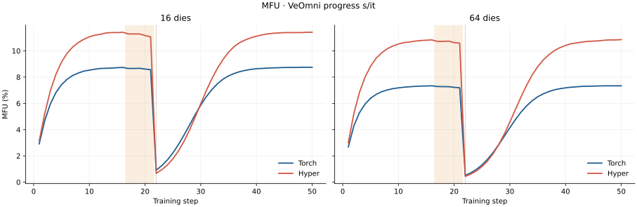
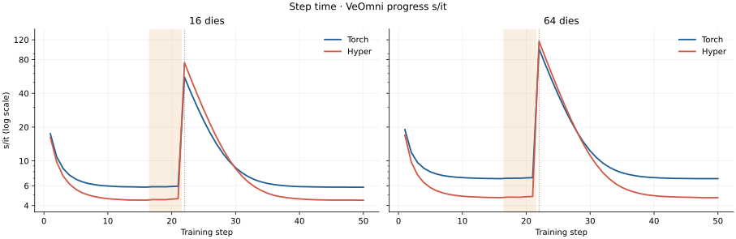

# Qwen3.5-35B-A3B：FSDP2 与 Hyper FSDP＋AdamW

## 假数据与负载均衡

使用 VeOmni 原生多模态数据流程加载落盘的 Parquet 假数据，数据源为已有的
`qwen_omni_offline_av`，训练时没有新增 Dataset 或 transform 适配。数据集有 4096 条样本，
分为 32 个文件，每个文件 128 条。每条样本包含：

- 一段对话：用户内容为 `<image><image><video>`，助手内容由重复的 `a ` 构造。
- 两张 64×64 的 PNG 图片，以及一个由 20 张 64×64 PNG 图片组成的视频。
- 样本 `id` 不同，文本、图片和视频内容相同。

使用本次 YAML 的 processor 和多模态配置后，每条样本为 8192 tokens，图像网格为
`[[1,4,4],[1,4,4]]`，视频网格为 `[[10,4,4]]`；经空间合并后分别对应 8 个图像
token 和 40 个视频 token。日志中的 rank 0 原生输出记录了这些网格和序列边界。

各 DP rank 通过原生分布式采样器获取不同样本索引，但样本内容、序列长度和媒体形状相同；
每 rank、每步使用一个样本，因此输入侧的文本和视觉计算量一致。这种构造不能保证设备执行、
专家路由或通信到达时间完全一致，也不能代表真实混合数据的负载分布。

两图使用 VeOmni rank 0 原生进度条中的 `s/it`，该值为平滑步速；第 22 步及其后的数值包含
在线 profiling 解析等待的影响。

## Profiling：通信与主流拷贝

表中数据来自原生 profiling 数据库；VeOmni 训练日志不打印这些通信和拷贝耗时。

| die | 方案 | FSDP 组通信掩盖率 | 未掩盖通信（ms） | AllGather（ms） | ReduceScatter（ms） | AllGather copy-out（ms） | ReduceScatter copy-in / chunk-cat（ms） |
| --- | --- | ---: | ---: | ---: | ---: | ---: | ---: |
| 16 | Torch | 76.51% | 1141.294 | 2337.331 | 2506.895 | 358.993 | 470.414 |
| 16 | Hyper | 81.15% | 615.208 | 1412.758 | 1839.693 | - | - |
| 64 | Torch | 61.60% | 2390.446 | 2951.609 | 3268.562 | 307.914 | 580.821 |
| 64 | Hyper | 77.30% | 905.611 | 1774.406 | 2207.771 | - | - |
