# VeOmni＋HyperParallel实验报告

<!-- markdownlint-configure-file {"MD033": {"allowed_elements": ["img", "sub"]}} -->
## 1. 性能实验

Profiling：仅采集rank 0的CPU/NPU时间线，使用Level0；第17–19步预热，第20–21步正式采集，不采集shape、调用栈和显存快照。

表中单步耗时为第23–50步平均耗时：`(T50 − T22) / 28`。T取自CSV的`elapsed_seconds`列，表示对应step的累计耗时（秒级精度）。

MFU按VeOmni公式离线估算，五组统一使用日志中的平滑s/it；profiling导出会影响后续平滑值。

### 16die

**Qwen3.5-35B-A3B，8K，16die，SP=1、EP=1，GBS=16，每组50步。**

配置：[Torch FSDP2＋AdamW](assets/config/torch_fsdp2_adamw_16die_8k.yaml)；[Hyper FSDP＋AdamW](assets/config/hyper_fsdp2_adamw_16die_8k.yaml)；[Torch FSDP2＋VeOmni Muon std](assets/config/torch_fsdp2_veomni_muon_16die_8k.yaml)；[Torch FSDP2＋Hyper Muon std](assets/config/torch_fsdp2_hyper_muon_16die_8k.yaml)；[Hyper FSDP＋Hyper Muon std](assets/config/hyper_fsdp2_hyper_muon_16die_8k.yaml)。

| 方案 | 对比基线 | 单步耗时(s) | 性能提升 | allocated / reserved(GiB) | 显存节省 allocated / reserved |
| --- | --- | ---: | ---: | ---: | ---: |
| Torch FSDP2＋AdamW | — | 5.7857 | — | 44.87 / 52.51 | — |
| Hyper FSDP＋AdamW | Torch FSDP2＋AdamW | 4.4286 | +30.65% | 44.91 / 46.46 | -0.07% / +11.52% |
| Torch FSDP2＋VeOmni Muon std | — | 6.1786 | — | 37.00 / 44.79 | — |
| Torch FSDP2＋Hyper Muon std | Torch FSDP2＋VeOmni Muon std | 5.9643 | +3.59% | 37.00 / 44.73 | +0.00% / +0.11% |
| Hyper FSDP＋Hyper Muon std | Torch FSDP2＋VeOmni Muon std | 4.2857 | +44.17% | 37.10 / 39.87 | -0.27% / +10.98% |

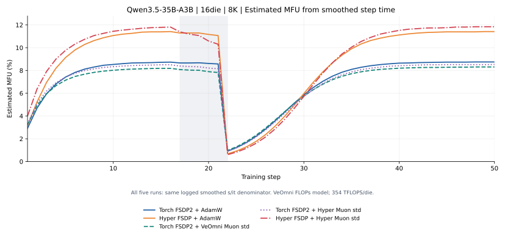

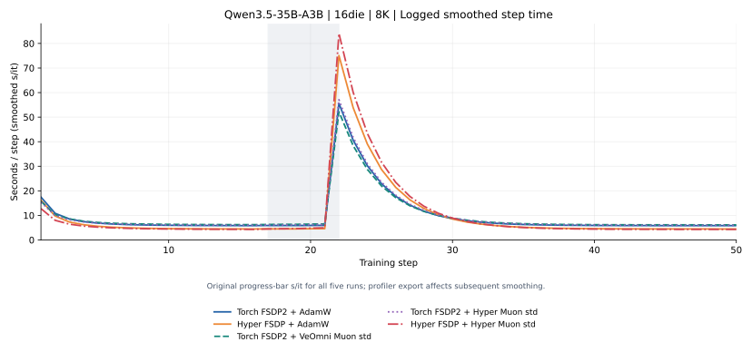

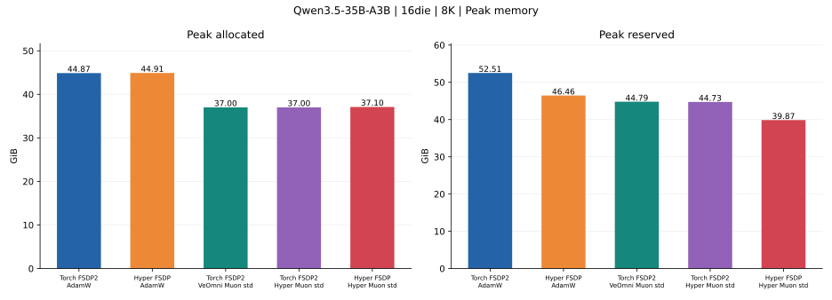

### 64die

**Qwen3.5-35B-A3B，8K，64die，SP=1、EP=1，GBS=64，每组50步。**

配置：[Torch FSDP2＋AdamW](assets/config/torch_fsdp2_adamw_64die_8k.yaml)；[Hyper FSDP＋AdamW](assets/config/hyper_fsdp2_adamw_64die_8k.yaml)；[Torch FSDP2＋VeOmni Muon std](assets/config/torch_fsdp2_veomni_muon_64die_8k.yaml)；[Torch FSDP2＋Hyper Muon std](assets/config/torch_fsdp2_hyper_muon_64die_8k.yaml)；[Hyper FSDP＋Hyper Muon std](assets/config/hyper_fsdp2_hyper_muon_64die_8k.yaml)。

| 方案 | 对比基线 | 单步耗时(s) | 性能提升 | allocated / reserved(GiB) | 显存节省 allocated / reserved |
| --- | --- | ---: | ---: | ---: | ---: |
| Torch FSDP2＋AdamW | — | 6.9286 | — | 20.91 / 25.87 | — |
| Hyper FSDP＋AdamW | Torch FSDP2＋AdamW | 4.6786 | +48.09% | 20.87 / 22.16 | +0.19% / +14.32% |
| Torch FSDP2＋VeOmni Muon std | — | 7.2857 | — | 18.98 / — | — |
| Torch FSDP2＋Hyper Muon std | Torch FSDP2＋VeOmni Muon std | 7.2143 | +0.99% | 18.98 / — | +0.00% / — |
| Hyper FSDP＋Hyper Muon std | Torch FSDP2＋VeOmni Muon std | 4.6786 | +55.73% | 19.01 / — | -0.16% / — |

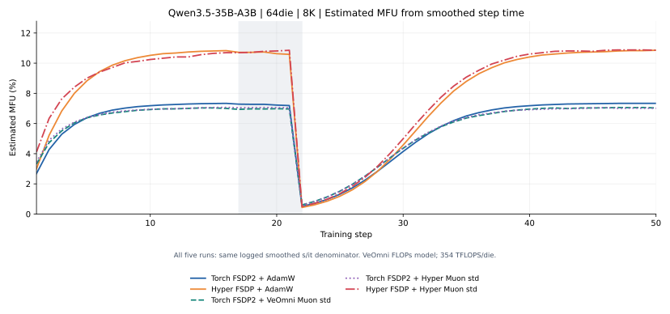

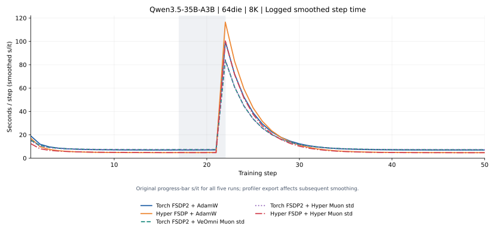

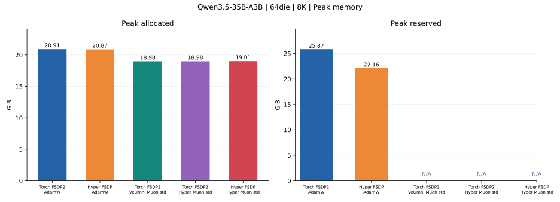

## 2. 精度实验

### 64die

Qwen3.5-35B-A3B，8K，64die，每组50步，关闭profiling。

配置：[Torch FSDP2＋AdamW](assets/config/torch_fsdp2_adamw_64die_8k_deterministic.yaml)、[Hyper FSDP＋AdamW](assets/config/hyper_fsdp2_adamw_64die_8k_deterministic.yaml)。

环境变量：`HCCL_DETERMINISTIC=strict`、`PYTHONHASHSEED=42`。

| 对照 | 条件 | Loss最大绝对差 | grad_norm最大绝对差 | 对比结果 |
| --- | --- | ---: | ---: | --- |
| Torch FSDP2＋AdamW / Hyper FSDP＋AdamW | 确定性 | 0 | 0 | 日志记录的50步Loss、grad_norm逐位一致 |

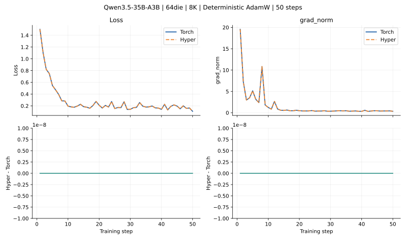

**实验数据**

| CSV | 日志 | 内容 |
| --- | --- | --- |
| [torch_fsdp2_adamw_16die_8k.csv](assets/csv/torch_fsdp2_adamw_16die_8k.csv) | [日志](assets/log/torch_fsdp2_adamw_16die_8k.log) | 16die，Torch FSDP2＋AdamW，50步 |
| [hyper_fsdp2_adamw_16die_8k.csv](assets/csv/hyper_fsdp2_adamw_16die_8k.csv) | [日志](assets/log/hyper_fsdp2_adamw_16die_8k.log) | 16die，Hyper FSDP＋AdamW，50步 |
| [torch_fsdp2_veomni_muon_16die_8k.csv](assets/csv/torch_fsdp2_veomni_muon_16die_8k.csv) | [日志](assets/log/torch_fsdp2_veomni_muon_16die_8k.log) | 16die，Torch FSDP2＋VeOmni Muon std，50步 |
| [torch_fsdp2_hyper_muon_16die_8k.csv](assets/csv/torch_fsdp2_hyper_muon_16die_8k.csv) | [日志](assets/log/torch_fsdp2_hyper_muon_16die_8k.log) | 16die，Torch FSDP2＋Hyper Muon std，50步 |
| [hyper_fsdp2_hyper_muon_16die_8k.csv](assets/csv/hyper_fsdp2_hyper_muon_16die_8k.csv) | [日志](assets/log/hyper_fsdp2_hyper_muon_16die_8k.log) | 16die，Hyper FSDP＋Hyper Muon std，50步 |
| [torch_fsdp2_adamw_64die_8k.csv](assets/csv/torch_fsdp2_adamw_64die_8k.csv) | [日志](assets/log/torch_fsdp2_adamw_64die_8k.log) | 64die，Torch FSDP2＋AdamW，50步 |
| [hyper_fsdp2_adamw_64die_8k.csv](assets/csv/hyper_fsdp2_adamw_64die_8k.csv) | [日志](assets/log/hyper_fsdp2_adamw_64die_8k.log) | 64die，Hyper FSDP＋AdamW，50步 |
| [torch_fsdp2_veomni_muon_64die_8k.csv](assets/csv/torch_fsdp2_veomni_muon_64die_8k.csv) | [日志](assets/log/torch_fsdp2_veomni_muon_64die_8k.log) | 64die，Torch FSDP2＋VeOmni Muon std，50步 |
| [torch_fsdp2_hyper_muon_64die_8k.csv](assets/csv/torch_fsdp2_hyper_muon_64die_8k.csv) | [日志](assets/log/torch_fsdp2_hyper_muon_64die_8k.log) | 64die，Torch FSDP2＋Hyper Muon std，50步 |
| [hyper_fsdp2_hyper_muon_64die_8k.csv](assets/csv/hyper_fsdp2_hyper_muon_64die_8k.csv) | [日志](assets/log/hyper_fsdp2_hyper_muon_64die_8k.log) | 64die，Hyper FSDP＋Hyper Muon std，50步 |
| [torch_fsdp2_adamw_64die_8k_deterministic.csv](assets/csv/torch_fsdp2_adamw_64die_8k_deterministic.csv) | [日志](assets/log/torch_fsdp2_adamw_64die_8k_deterministic.log) | 64die，Torch FSDP2＋AdamW，确定性，50步 |
| [hyper_fsdp2_adamw_64die_8k_deterministic.csv](assets/csv/hyper_fsdp2_adamw_64die_8k_deterministic.csv) | [日志](assets/log/hyper_fsdp2_adamw_64die_8k_deterministic.log) | 64die，Hyper FSDP＋AdamW，确定性，50步 |
| [memory_summary.csv](assets/csv/memory_summary.csv) | — | 上述12组实验的最终显存峰值汇总 |
| [memory_by_rank.csv](assets/csv/memory_by_rank.csv) | — | 上述7组性能实验的逐rank最终显存峰值 |

## 附录：数据说明

实验使用落盘为Parquet的合成多模态数据，通过VeOmni原生数据流程加载，沿用`qwen_omni_offline_av`数据源，无需新增Dataset或transform适配。数据集共4096条样本，分为32个文件，每个文件128条。

每条样本包含一段对话：用户内容为`<image><image><video>`，助手内容由重复的字母`a`及其后的空格构造；媒体输入为两张64×64的PNG图片，以及一个由20张64×64 PNG图片组成的视频。各样本的id不同，文本、图片和视频内容相同。

经过对应配置的processor处理后，每条样本为8192 tokens，图像网格为`[[1,4,4],[1,4,4]]`，视频网格为`[[10,4,4]]`；经空间合并后分别对应8个图像token和40个视频token。

各DP rank通过VeOmni原生分布式采样器获取不同样本索引，每个rank每步使用一个样本。由于样本内容、序列长度和媒体形状相同，输入侧的文本与视觉计算量保持一致；这种合成数据构造不保证专家路由、设备执行或通信到达时间完全一致，也不代表真实混合数据的负载分布。

## 附录：Profiling结果

以下profiling分析统一取`ProfilerStep#20`。

### 16die

Profiling分析结果：

| 方案 | 计算(ms) | 通信(ms) | 未掩盖通信(ms) | 通信掩盖率 | Optimizer.step(ms) |
| --- | ---: | ---: | ---: | ---: | ---: |
| Torch FSDP2＋AdamW | 4320.434 | 4853.422 | 1138.577 | 76.54% | 57.96 |
| Hyper FSDP＋AdamW | 3603.371 | 3226.979 | 581.729 | 81.97% | 43.92 |
| Torch FSDP2＋VeOmni Muon std | 4278.925 | 4887.050 | 1549.761 | 68.29% | 459.17 |
| Torch FSDP2＋Hyper Muon std | 4127.344 | 4872.502 | 1522.286 | 68.76% | 310.30 |
| Hyper FSDP＋Hyper Muon std | 3337.312 | 2835.200 | 802.822 | 71.68% | 285.53 |

固定Torch FSDP2，Hyper Muon的优化器阶段耗时下降约32.42%；切换Hyper FSDP后，计算和未掩盖通信区间也进一步缩短。

下方profiling截图显示，Hyper Muon确实缩短了优化器阶段耗时；但整步训练耗时存在波动，因此端到端收益不明显。

#### Torch FSDP2＋VeOmni Muon std

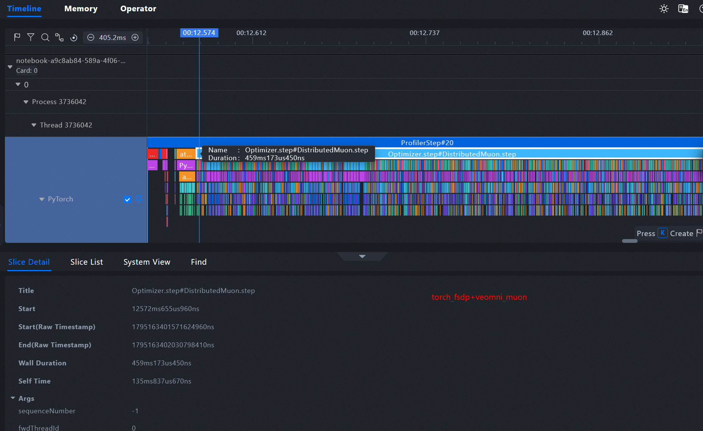

#### Torch FSDP2＋Hyper Muon std

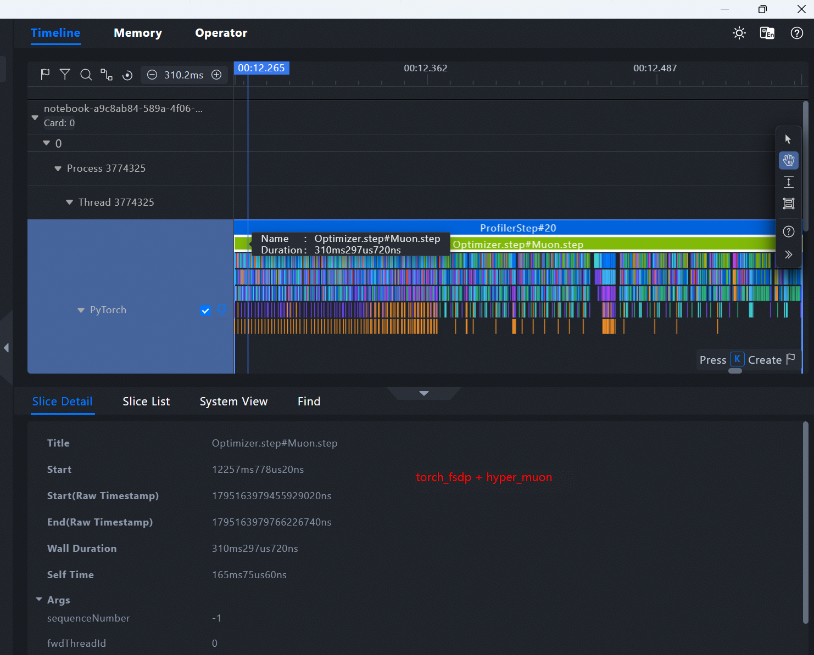

### 64die

#### Muon三组整体对比

Profiling分析结果：

| 方案 | 计算(ms) | 通信(ms) | 未掩盖通信(ms) | 通信掩盖率 | Muon阶段(ms) |
| --- | ---: | ---: | ---: | ---: | ---: |
| Torch FSDP2＋VeOmni Muon std | 3637.911 | 6329.394 | 3143.246 | 50.34% | 317.7 |
| Torch FSDP2＋Hyper Muon std | 3591.940 | 6390.992 | 3210.700 | 49.76% | 213.7 |
| Hyper FSDP＋Hyper Muon std | 2998.626 | 4046.542 | 1453.984 | 64.07% | 208.4 |

固定Torch FSDP2时，Hyper Muon使优化器阶段耗时下降32.74%，但受整步耗时波动影响，端到端收益不明显。

搭配Hyper FSDP后，计算耗时进一步下降，未掩盖通信减少54.71%，带来更明显的整步收益。

#### FSDP通信对比（AdamW）

Profiling结果：

| die | 方案 | FSDP组通信掩盖率 | 未掩盖通信(ms) | AllGather(ms) | ReduceScatter(ms) | AllGather copy-out(ms) | ReduceScatter copy-in / chunk-cat(ms) |
| --- | --- | ---: | ---: | ---: | ---: | ---: | ---: |
| 64 | Torch | 61.57% | 2392.875 | 2952.263 | 3269.108 | 307.939 | 580.623 |
| 64 | Hyper | 78.04% | 867.666 | 1769.385 | 2171.511 | — | — |

Hyper的FSDP组通信掩盖率提高16.48个百分点，未掩盖通信减少约63.74%。

#### Torch FSDP2＋VeOmni Muon std

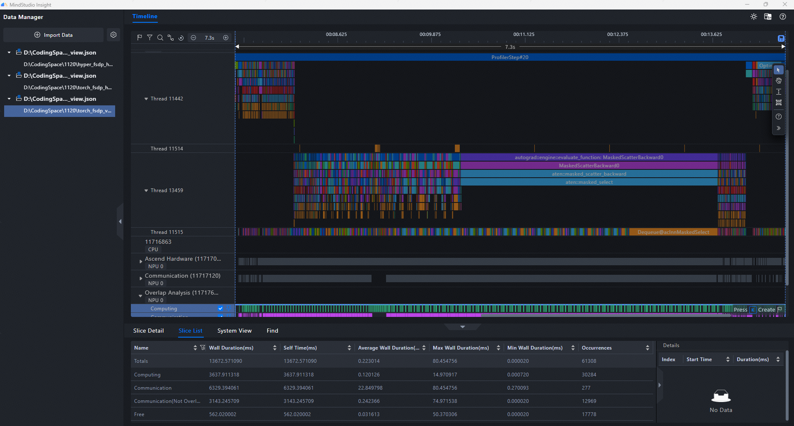

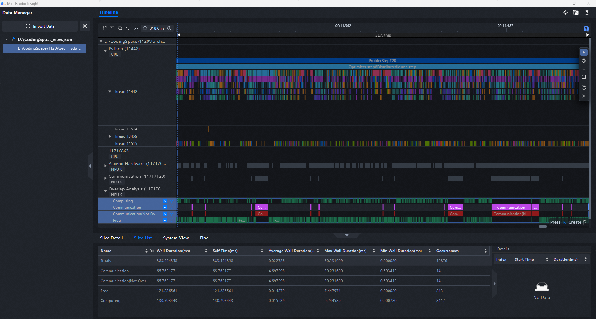

#### Torch FSDP2＋Hyper Muon std

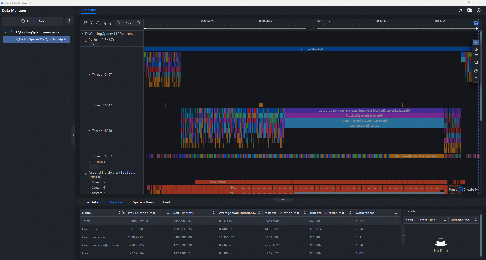

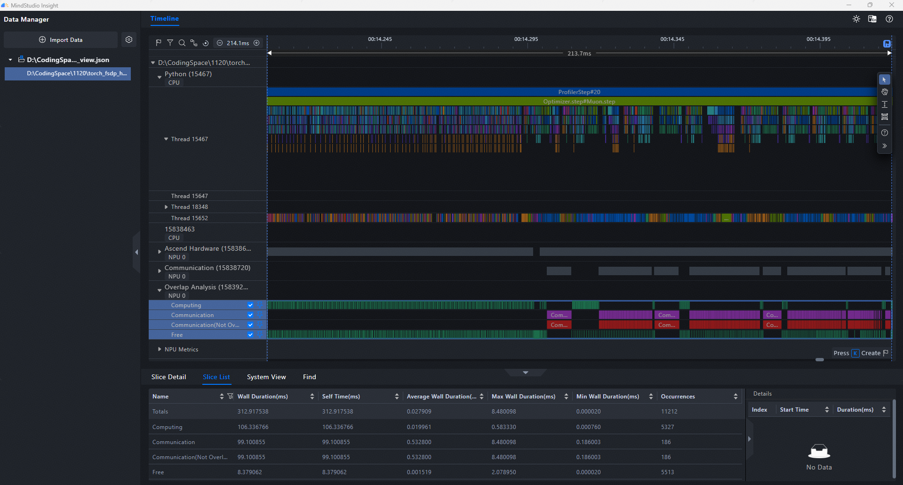

#### Hyper FSDP＋Hyper Muon std

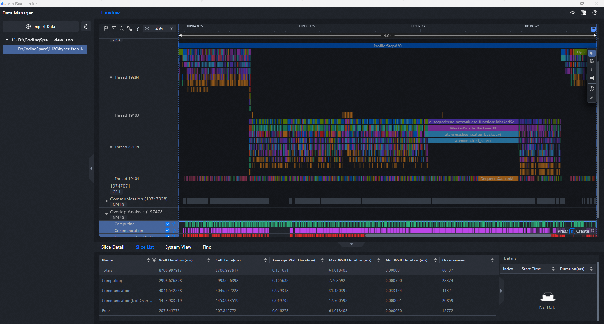

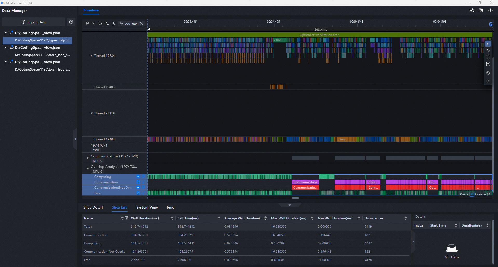

## Qwen3.5-35B-A3B实验说明

### 16die扩到64die后收益增大的原因

AdamW的16die与64die性能对比：

| 方案 | 16die单步耗时(s) | 64die单步耗时(s) | 扩卡后步时增长 |
| --- | ---: | ---: | ---: |
| Torch FSDP2＋AdamW | 5.7857 | 6.9286 | +19.75% |
| Hyper FSDP＋AdamW | 4.4286 | 4.6786 | +5.65% |

根据AdamW profiling第20步的实验结果：

| 规模 | 方案 | Computing(ms) | 通信(ms) | 未掩盖通信(ms) | 通信掩盖率 | AG copy-out(ms) | RS copy-in / chunk-cat(ms) |
| --- | --- | ---: | ---: | ---: | ---: | ---: | ---: |
| 16die | Torch | 4320.434 | 4853.422 | 1138.577 | 76.54% | 359.252 | 470.240 |
| 16die | Hyper | 3603.371 | 3226.979 | 581.729 | 81.97% | — | — |
| 64die | Torch | 4182.321 | 6226.073 | 2392.875 | 61.57% | 307.939 | 580.623 |
| 64die | Hyper | 3510.638 | 3951.516 | 867.666 | 78.04% | — | — |

Computing包含模型计算及FSDP数据搬运。

同一步profiling中的AllGather输入长度对齐情况：

| 规模 | 方案 | AllGather次数 | 输入非512B对齐次数 | 其中输入≥1MiB的次数 | AllGather耗时(ms) | 未对齐AllGather累计耗时(ms) |
| --- | --- | ---: | ---: | ---: | ---: | ---: |
| 16die | Torch | 189 | 189 | 189 | 2334.357 | 2334.357 |
| 16die | Hyper | 2706 | 1476 | 0 | 1384.719 | 289.803 |
| 64die | Torch | 189 | 189 | 81 | 2952.263 | 2952.263 |
| 64die | Hyper | 2706 | 1368 | 0 | 1769.385 | 307.499 |

选取每卡输入大于1MiB的主要AllGather，对比16die→64die：

| 方案 | 聚合输出(MiB) | 每步次数 | 每卡输入(MiB) | 单次耗时(ms) | 通信掩盖率 |
| --- | ---: | ---: | ---: | ---: | ---: |
| Torch | 1595.071→1595.259 | 20→20 | 99.692→24.926 | 18.712→34.512 | 99.90%→55.84% |
| Torch | 1607.383→1607.821 | 60→60 | 100.461→25.122 | 31.328→35.899 | 61.35%→45.86% |
| Torch | 2006.961→2006.961 | 1→1 | 125.435→31.359 | 30.515→35.297 | 0.00%→0.00% |
| Hyper | 1024→1024 | 80→80 | 64→16 | 7.958→9.910 | 88.46%→89.40% |
| Hyper | 512→512 | 80→80 | 32→8 | 3.686→5.169 | 85.52%→63.83% |

从16die扩展至64die，Torch和Hyper的通信耗时分别增长28.28%和22.45%，但未掩盖通信分别增长110.16%和49.15%。Torch扩卡后暴露了更多通信耗时，整步耗时增长19.75%，Hyper仅增长5.65%，使Hyper相对Torch的性能提升由30.65%增至48.09%。

[HCCL官方案例](https://www.hiascend.com/document/detail/zh/mindstudio/82RC1/practicalcases/GeneralPerformanceIssue/toolsample6_046.html)中，AllGather源、目标地址未按512B对齐导致通信带宽显著下降，增加对齐padding后，耗时从350ms降至50ms。

Torch将多个权重融合后进行AllGather，大块通信的输入长度均未按512B对齐，可能影响通信效率。从单机16die扩展到四机64die后，这些通信的总耗时从2334.357ms增至2952.263ms。2006.961MiB的AllGather耗时也从30.515ms增至35.297ms。表中约1595MiB的AllGather原本几乎完全被计算掩盖，扩卡后掩盖率降至55.84%。Hyper也有未对齐的通信，但输入都小于1MiB，总耗时只从289.803ms增至307.499ms；1024MiB大权重的AllGather仍能保持约89%的掩盖率。

#### 16die

| Torch FSDP2＋AdamW | Hyper FSDP＋AdamW |
| --- | --- |
| 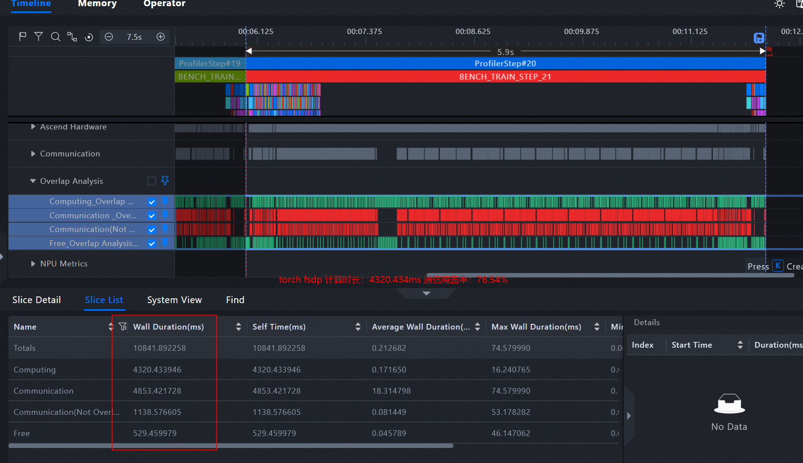 | 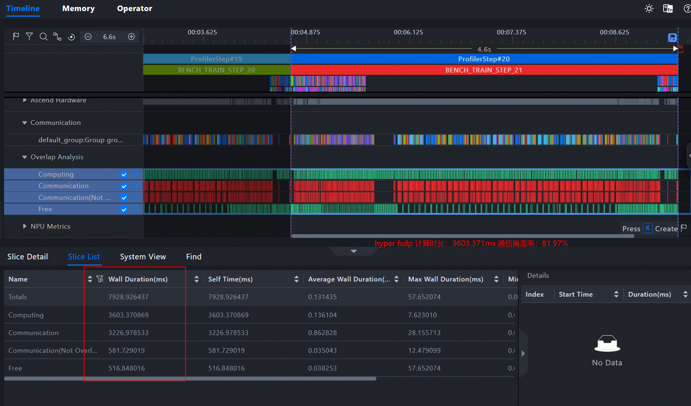 |

#### 64die

| Torch FSDP2＋AdamW | Hyper FSDP＋AdamW |
| --- | --- |
| 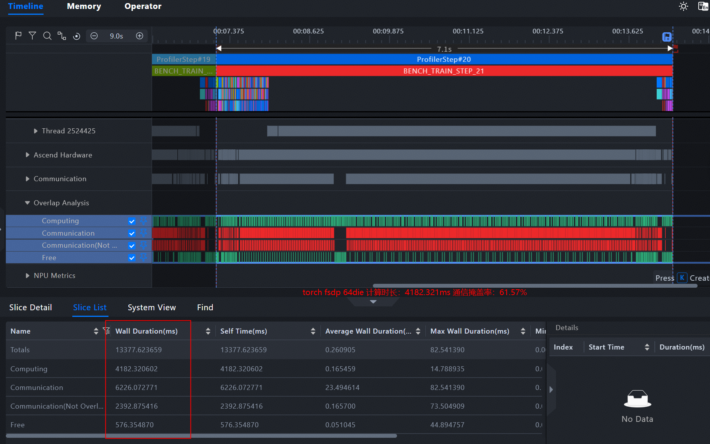 | 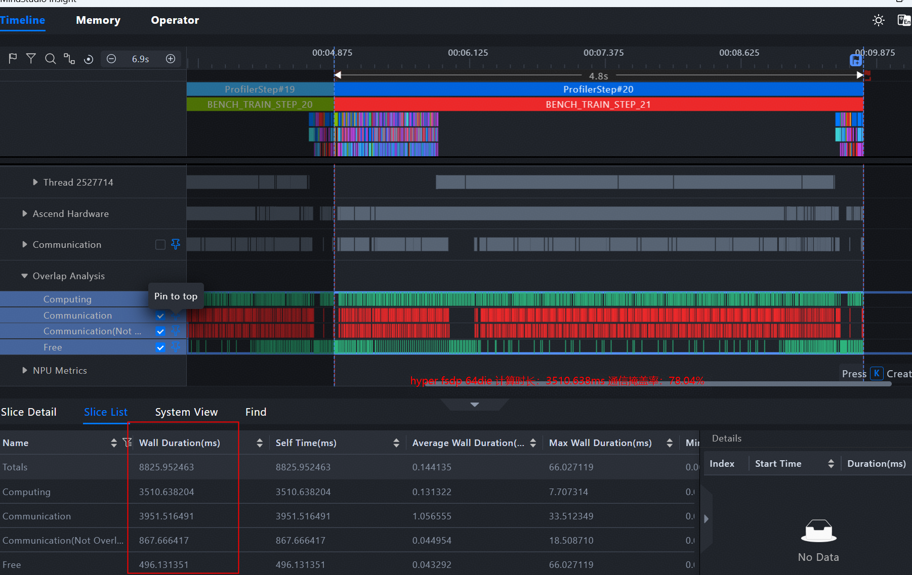 |

### 仅替换Muon时整步变化较小的原因

结合上方[16die](#16die-1)、[64die](#64die-2)的profiling结果及优化器时间线，汇总如下：

| 规模 | 方案 | 第20步优化器阶段耗时(ms) | 优化器阶段耗时下降 | 平均单步耗时(s) | 端到端性能提升 |
| --- | --- | ---: | ---: | ---: | ---: |
| 16die | Torch FSDP2＋VeOmni Muon std | 459.17 | — | 6.1786 | — |
| 16die | Torch FSDP2＋Hyper Muon std | 310.30 | 32.42% | 5.9643 | 3.59% |
| 16die | Hyper FSDP＋Hyper Muon std | 285.53 | 37.82% | 4.2857 | 44.17% |
| 64die | Torch FSDP2＋VeOmni Muon std | 317.70 | — | 7.2857 | — |
| 64die | Torch FSDP2＋Hyper Muon std | 213.70 | 32.74% | 7.2143 | 0.99% |
| 64die | Hyper FSDP＋Hyper Muon std | 208.40 | 34.40% | 4.6786 | 55.73% |

Hyper Muon在16die和64die下都将优化器阶段缩短了约三分之一，但前反向和通信仍占整步的大部分时间，加上整步耗时存在波动，仅替换Muon的端到端收益较小。进一步切换Hyper FSDP后，Hyper Muon的阶段耗时变化不大，整步耗时却明显下降，说明额外收益主要来自FSDP相关的搬运和通信优化。

## Qwen3.8-Flash-Next实验说明

### 实验配置

64die，FSDP shard=64、replicate=1，SP=1、EP=16、PerLayerEngram=8，使用AdamW；对比4K、8K、16K序列。视觉塔启用`comm_fusion_vit`，专家参数沿dim-0切分。

### 实验结果

| 序列长度 | 方案 | 单步耗时(s) | 步时下降 | allocated / reserved峰值(GiB) | 显存节省 allocated / reserved |
| --- | --- | ---: | ---: | ---: | ---: |
| 4K | Torch FSDP2＋AdamW | 3.079607 | — | 28.438 / 35.131 | — |
| 4K | Hyper FSDP＋AdamW | 2.913472 | 5.39% | 27.585 / 31.029 | 3.00% / 11.68% |
| 8K | Torch FSDP2＋AdamW | 6.273818 | — | 30.558 / 37.137 | — |
| 8K | Hyper FSDP＋AdamW | 6.075657 | 3.16% | 30.300 / 32.670 | 0.84% / 12.03% |
| 16K | Torch FSDP2＋AdamW | 11.643254 | — | 37.181 / 42.998 | — |
| 16K | Hyper FSDP＋AdamW | 11.479438 | 1.41% | 37.409 / 39.291 | -0.61% / 8.62% |

即使在4K序列下，FSDP通信也能达到较高的掩盖率，本次收益主要来自Hyper FSDP节省的Copy-in/Copy-out流程。性能提升比例取决于拷贝操作占总计算时间的比例：序列变长、计算耗时增加后，本组实验中的相对收益逐渐减小。

### 优化点

- **PLE路由索引**：用索引计算替代大张量`repeat_interleave`，4K profiling中两侧各6个大核均消失。
- **PLE聚合融合**：将多次`index_copy`合并为一次`PLESelect`，前向使用融合scatter、反向使用gather，减少重复访存和算子下发。
- **QSA与Triton packed元数据**：利用真实EOD边界缓存QSA metadata和GDN chunk indices，减少重复构造；不满足固定4K边界条件的数据走通用路径。
- **路由与split复用**：缓存PLE rank表，并复用前向产生的PLE/MoE分组信息，减少重算时重复的`tolist`和元数据准备。
- **MoE流同步**：固定路由下，首次前向等待counts就绪，反向和重算复用通信metadata。

### 4K Profiling

#### 未掩盖通信拆解

4K序列、rank 0第15步；比例以各方案未掩盖通信总时间为分母。

| 通信域 | Torch FSDP2＋AdamW（ms） | 占比 | Hyper FSDP＋AdamW（ms） | 占比 |
| --- | ---: | ---: | ---: | ---: |
| EP16 | 337.611 | 50.99% | 330.724 | 55.46% |
| PLE flat64 | 115.407 | 17.43% | 107.384 | 18.01% |
| FSDP64 | 190.160 | 28.72% | 152.674 | 25.60% |
| EFSDP4 | 14.228 | 2.15% | 0.766 | 0.13% |
| 其他 | 4.739 | 0.72% | 4.828 | 0.81% |
| 合计 | 662.145 | 100% | 596.376 | 100% |

与EP并发的FSDP通信计入EP；其余重叠按PLE flat64、FSDP64、EFSDP4的顺序归属。PLE flat64与FSDP64共享通信组，按All-to-All与AllGather/ReduceScatter区分。

#### 前向

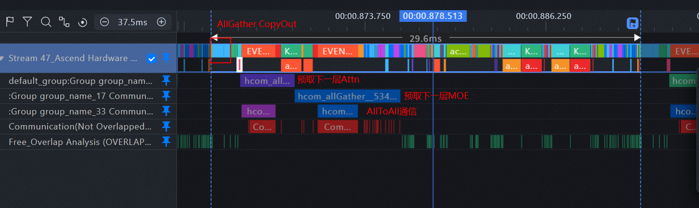

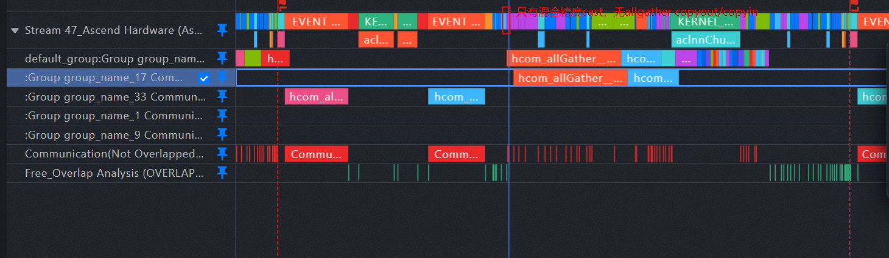

#### 反向

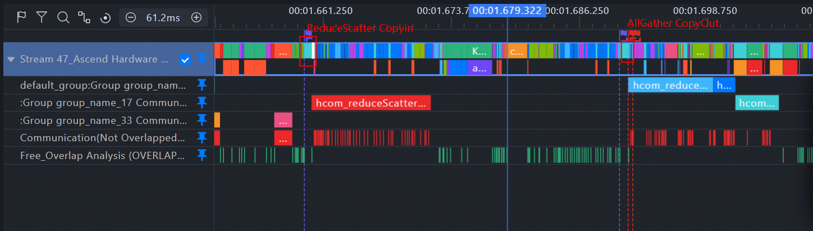

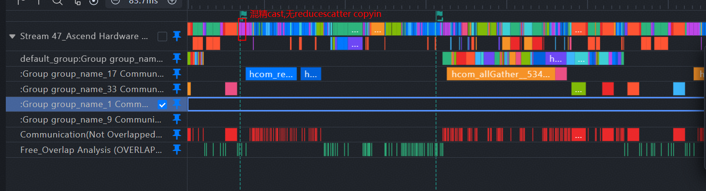
