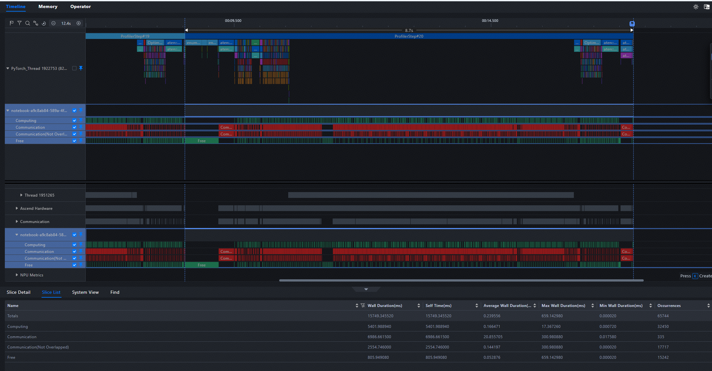
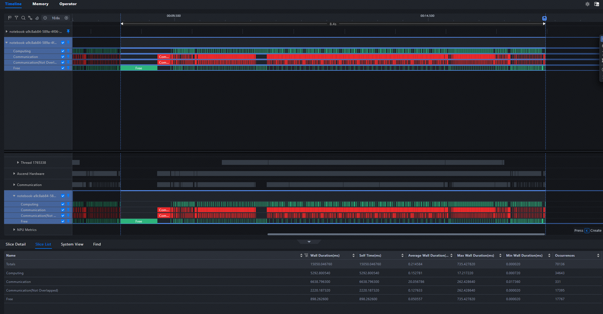
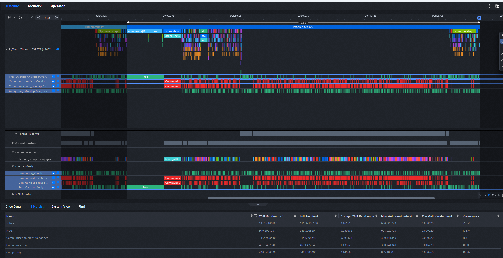
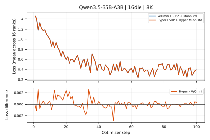
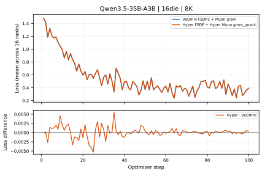

# HyperParallel × VeOmni 训练实验报告

本文在 `docs/veomni-benchmark-report` 分支协作维护，汇总后同步到 [Gist 报告](https://gist.github.com/Cui-yshoho/5a912d774a3693815387fb635b5e46d3)。

## 如何补充结果

- PR 的目标仓库选择 `Cui-yshoho/hyper-parallel`，目标分支选择 `docs/veomni-benchmark-report`。
- 在对应实验下补充配置、数据、性能与显存结果，以及精度图和 profiling 截图；尚未运行的项目保持“待补充”。
- 图片放在 `docs/benchmarks/assets/veomni/`，在本文中使用相对路径引用。原始 profiling 大包不提交到 Git。
- 性能提升按“基线步时 / Hyper 步时 − 1”计算；显存节省分别比较 allocated 和 reserved。

## 实验一：Qwen3.5-35B-A3B

### 单机16die

基于 VeOmni 官方 example：[AdamW](https://github.com/ByteDance-Seed/VeOmni/blob/main/configs/multimodal/qwen3_5_moe/qwen3_5_moe_vl_ascendc.yaml)、[Muon](https://github.com/ByteDance-Seed/VeOmni/blob/main/configs/multimodal/qwen3_5_moe/qwen3_5_moe_vl_muon_ascendc.yaml)，加载完整预训练权重，其余模型、算子及优化器配置沿用对应 example。

数据：Tulu-3 SFT、ShareGPT4V COCO图文128条、LLaVA视频10条，权重依次为0.2、0.4、0.4；图文和视频重复采样。

环境变量：`CPU_AFFINITY_CONF=2`、`TASK_QUEUE_ENABLE=2`、`PYTORCH_NPU_ALLOC_CONF=expandable_segments:True`。

```text
16die，SP=1，EP=1，FSDP shard=16，replicate=1
完全重算（非重入），每rank序列长度8K
micro batch size=1，梯度累加数=1，GBS=16；每组100步
```

#### 实验情况

| 序列长度 | 方案 | 单步耗时（s） | 性能提升（%） | 峰值显存 allocated / reserved（GiB） | 显存节省 allocated / reserved（%） |
| --- | --- | --- | --- | --- | --- |
| 8K | **VeOmni FSDP2＋AdamW（基线）** | 7.6753 | — | 47.24 / 54.99 | — / — |
| 8K | Hyper FSDP＋AdamW | 5.8394 | 31.44 | 47.34 / 50.70 | -0.21 / 7.80 |
| 8K | **VeOmni FSDP2＋VeOmni Muon std（基线）** | 7.8928 | — | 39.30 / 47.13 | — / — |
| 8K | Hyper FSDP＋Hyper Muon std | 6.0993 | 29.40 | 39.40 / 42.66 | -0.25 / 9.48 |
| 8K | **VeOmni FSDP2＋VeOmni Muon gram（基线）** | 7.9489 | — | 39.30 / 47.11 | — / — |
| 8K | Hyper FSDP＋Hyper Muon gram_quack | 6.1949 | 28.31 | 39.40 / 42.74 | -0.25 / 9.28 |

基线各完成1次，Hyper各完成2次；耗时取已完成结果的均值，显存取最大值。耗时为训练计算区间的CPU墙钟统计，不含数据加载及profiling。

VeOmni native Muon在NPU上配置 `gram_quack` 时会回退到 `gram`。

#### Profiling

##### 8K · VeOmni FSDP2＋AdamW


##### 8K · Hyper FSDP＋AdamW


##### 8K · VeOmni FSDP2＋VeOmni Muon std



##### 8K · Hyper FSDP＋Hyper Muon std


##### 8K · VeOmni FSDP2＋VeOmni Muon gram



##### 8K · Hyper FSDP＋Hyper Muon gram_quack



#### 精度对比

##### 8K

VeOmni FSDP2＋AdamW / Hyper FSDP＋AdamW


VeOmni FSDP2＋VeOmni Muon std / Hyper FSDP＋Hyper Muon std



VeOmni FSDP2＋VeOmni Muon gram / Hyper FSDP＋Hyper Muon gram_quack



### 4机64die

配置：待补充。

数据：待补充。

环境变量：`CPU_AFFINITY_CONF=2`、`TASK_QUEUE_ENABLE=2`、`PYTORCH_NPU_ALLOC_CONF=expandable_segments:True`。

```text
64die，SP=1，EP=1，HSDP shard=32，replicate=2
每rank序列长度16K
```

#### 实验情况

| 序列长度 | 方案 | 单步耗时（s） | 性能提升（%） | 峰值显存 allocated / reserved（GiB） | 显存节省 allocated / reserved（%） |
| --- | --- | --- | --- | --- | --- |
| 16K | **VeOmni FSDP2＋AdamW（基线）** | 待补充 | — | 待补充 / 待补充 | — / — |
| 16K | Hyper HSDP＋AdamW | 待补充 | 待补充 | 待补充 / 待补充 | 待补充 / 待补充 |
| 16K | **VeOmni FSDP2＋VeOmni Muon std（基线）** | 待补充 | — | 待补充 / 待补充 | — / — |
| 16K | Hyper HSDP＋Hyper Muon std | 待补充 | 待补充 | 待补充 / 待补充 | 待补充 / 待补充 |
| 16K | **VeOmni FSDP2＋VeOmni Muon gram（基线）** | 待补充 | — | 待补充 / 待补充 | — / — |
| 16K | Hyper HSDP＋Hyper Muon gram_quack | 待补充 | 待补充 | 待补充 / 待补充 | 待补充 / 待补充 |

#### Profiling

##### 16K · VeOmni FSDP2＋AdamW

截图待补充。

##### 16K · Hyper HSDP＋AdamW

截图待补充。

##### 16K · VeOmni FSDP2＋VeOmni Muon std

截图待补充。

##### 16K · Hyper HSDP＋Hyper Muon std

截图待补充。

##### 16K · VeOmni FSDP2＋VeOmni Muon gram

截图待补充。

##### 16K · Hyper HSDP＋Hyper Muon gram_quack

截图待补充。

#### 精度对比

##### 16K

VeOmni FSDP2＋AdamW / Hyper HSDP＋AdamW loss对比图：待补充。

VeOmni FSDP2＋VeOmni Muon std / Hyper HSDP＋Hyper Muon std loss对比图：待补充。

VeOmni FSDP2＋VeOmni Muon gram / Hyper HSDP＋Hyper Muon gram_quack loss对比图：待补充。

## 实验二：Qwen3.8-Flash-Next

配置：待补充。

数据：待补充。

环境变量：`CPU_AFFINITY_CONF=2`、`TASK_QUEUE_ENABLE=2`、`PYTORCH_NPU_ALLOC_CONF=expandable_segments:True`。

### 8机128die

```text
128die，SP=8，EP=8，FSDP shard=128
每rank序列长度16K
```

#### 实验情况

| 序列长度 | 方案 | 单步耗时（s） | 性能提升（%） | 峰值显存 allocated / reserved（GiB） | 显存节省 allocated / reserved（%） |
| --- | --- | --- | --- | --- | --- |
| 16K | **VeOmni FSDP2＋AdamW（基线）** | 待补充 | — | 待补充 / 待补充 | — / — |
| 16K | Hyper FSDP＋AdamW | 待补充 | 待补充 | 待补充 / 待补充 | 待补充 / 待补充 |
| 16K | **VeOmni FSDP2＋VeOmni Muon std（基线）** | 待补充 | — | 待补充 / 待补充 | — / — |
| 16K | Hyper FSDP＋Hyper Muon std | 待补充 | 待补充 | 待补充 / 待补充 | 待补充 / 待补充 |
| 16K | **VeOmni FSDP2＋VeOmni Muon gram（基线）** | 待补充 | — | 待补充 / 待补充 | — / — |
| 16K | Hyper FSDP＋Hyper Muon gram_quack | 待补充 | 待补充 | 待补充 / 待补充 | 待补充 / 待补充 |

#### Profiling

##### 16K · VeOmni FSDP2＋AdamW

截图待补充。

##### 16K · Hyper FSDP＋AdamW

截图待补充。

##### 16K · VeOmni FSDP2＋VeOmni Muon std

截图待补充。

##### 16K · Hyper FSDP＋Hyper Muon std

截图待补充。

##### 16K · VeOmni FSDP2＋VeOmni Muon gram

截图待补充。

##### 16K · Hyper FSDP＋Hyper Muon gram_quack

截图待补充。

#### 精度对比

##### 16K

VeOmni FSDP2＋AdamW / Hyper FSDP＋AdamW loss对比图：待补充。

VeOmni FSDP2＋VeOmni Muon std / Hyper FSDP＋Hyper Muon std loss对比图：待补充。

VeOmni FSDP2＋VeOmni Muon gram / Hyper FSDP＋Hyper Muon gram_quack loss对比图：待补充。

## 实验三：Qwen3.5-397B-A17B

配置：待补充。

数据：待补充。

环境变量：`CPU_AFFINITY_CONF=2`、`TASK_QUEUE_ENABLE=2`、`PYTORCH_NPU_ALLOC_CONF=expandable_segments:True`。

### 8机128die

```text
128die，SP=8，EP=8，FSDP shard=128
每rank序列长度8K / 16K
```

#### 实验情况

| 序列长度 | 方案 | 单步耗时（s） | 性能提升（%） | 峰值显存 allocated / reserved（GiB） | 显存节省 allocated / reserved（%） |
| --- | --- | --- | --- | --- | --- |
| 8K | **VeOmni FSDP2＋AdamW（基线）** | 待补充 | — | 待补充 / 待补充 | — / — |
| 8K | Hyper FSDP＋AdamW | 待补充 | 待补充 | 待补充 / 待补充 | 待补充 / 待补充 |
| 8K | **VeOmni FSDP2＋VeOmni Muon std（基线）** | 待补充 | — | 待补充 / 待补充 | — / — |
| 8K | Hyper FSDP＋Hyper Muon std | 待补充 | 待补充 | 待补充 / 待补充 | 待补充 / 待补充 |
| 8K | **VeOmni FSDP2＋VeOmni Muon gram（基线）** | 待补充 | — | 待补充 / 待补充 | — / — |
| 8K | Hyper FSDP＋Hyper Muon gram_quack | 待补充 | 待补充 | 待补充 / 待补充 | 待补充 / 待补充 |
| 16K | **VeOmni FSDP2＋AdamW（基线）** | 待补充 | — | 待补充 / 待补充 | — / — |
| 16K | Hyper FSDP＋AdamW | 待补充 | 待补充 | 待补充 / 待补充 | 待补充 / 待补充 |
| 16K | **VeOmni FSDP2＋VeOmni Muon std（基线）** | 待补充 | — | 待补充 / 待补充 | — / — |
| 16K | Hyper FSDP＋Hyper Muon std | 待补充 | 待补充 | 待补充 / 待补充 | 待补充 / 待补充 |
| 16K | **VeOmni FSDP2＋VeOmni Muon gram（基线）** | 待补充 | — | 待补充 / 待补充 | — / — |
| 16K | Hyper FSDP＋Hyper Muon gram_quack | 待补充 | 待补充 | 待补充 / 待补充 | 待补充 / 待补充 |

#### Profiling

##### 8K · VeOmni FSDP2＋AdamW

截图待补充。

##### 8K · Hyper FSDP＋AdamW

截图待补充。

##### 8K · VeOmni FSDP2＋VeOmni Muon std

截图待补充。

##### 8K · Hyper FSDP＋Hyper Muon std

截图待补充。

##### 8K · VeOmni FSDP2＋VeOmni Muon gram

截图待补充。

##### 8K · Hyper FSDP＋Hyper Muon gram_quack

截图待补充。

##### 16K · VeOmni FSDP2＋AdamW

截图待补充。

##### 16K · Hyper FSDP＋AdamW

截图待补充。

##### 16K · VeOmni FSDP2＋VeOmni Muon std

截图待补充。

##### 16K · Hyper FSDP＋Hyper Muon std

截图待补充。

##### 16K · VeOmni FSDP2＋VeOmni Muon gram

截图待补充。

##### 16K · Hyper FSDP＋Hyper Muon gram_quack

截图待补充。

#### 精度对比

##### 8K

VeOmni FSDP2＋AdamW / Hyper FSDP＋AdamW loss对比图：待补充。

VeOmni FSDP2＋VeOmni Muon std / Hyper FSDP＋Hyper Muon std loss对比图：待补充。

VeOmni FSDP2＋VeOmni Muon gram / Hyper FSDP＋Hyper Muon gram_quack loss对比图：待补充。

##### 16K

VeOmni FSDP2＋AdamW / Hyper FSDP＋AdamW loss对比图：待补充。

VeOmni FSDP2＋VeOmni Muon std / Hyper FSDP＋Hyper Muon std loss对比图：待补充。

VeOmni FSDP2＋VeOmni Muon gram / Hyper FSDP＋Hyper Muon gram_quack loss对比图：待补充。
