# HyperParallel × VeOmni 训练实验报告

<!-- markdownlint-configure-file {"MD033": {"allowed_elements": ["img"]}} -->

## HyperParallel 接入配置

```yaml
hyper_parallel:
  comm_fusion: false        # 将参数/梯度打包到 buffer，进行融合通信
  comm_fusion_vit: null     # 单独控制视觉塔的通信融合；null 表示继承 comm_fusion
  forward_prefetch_depth: 1 # 前向预取后续 block 的数量，需开启 forward_prefetch
  backward_prefetch_depth: 1 # 反向预取前面 block 的数量
  reduce_comm_interval: 1   # 梯度归约通信的等待间隔，不是梯度累加步数
```

`apply_hyper_parallel_patch` 由 VeOmni 在模型构建前自动调用，根据配置将 FSDP/HSDP 或 Muon 的构建入口切换到 Hyper 实现，并适配权重加载、梯度裁剪和 checkpoint 保存恢复所需的 DTensor 转换；数据加载和训练循环仍由 VeOmni 管理。

## 实验一：Qwen3.5-35B-A3B

均衡多模态假数据的 8K、16 / 64 die FSDP＋AdamW 对照和 profiling 分析见
[独立报告](qwen3.5_fsdp_adam/README.md)。

### 单机16die

基于 VeOmni 官方 example：[AdamW](https://github.com/ByteDance-Seed/VeOmni/blob/main/configs/multimodal/qwen3_5_moe/qwen3_5_moe_vl_ascendc.yaml)、[Muon](https://github.com/ByteDance-Seed/VeOmni/blob/main/configs/multimodal/qwen3_5_moe/qwen3_5_moe_vl_muon_ascendc.yaml)，加载完整预训练权重，其余模型、算子及优化器配置沿用对应 example。

数据：Tulu-3 SFT、ShareGPT4V COCO图文128条、LLaVA视频10条，权重依次为0.2、0.4、0.4；图文和视频重复采样。

环境变量：`CPU_AFFINITY_CONF=2`、`TASK_QUEUE_ENABLE=2`、`PYTORCH_NPU_ALLOC_CONF=expandable_segments:True`。

```text
16die，SP=1，EP=1，FSDP shard=16，replicate=1
完全重算（非重入），每rank序列长度8K
micro batch size=1，梯度累加数=1，GBS=16；每组100步
```

FSDP开启前向预取；Hyper前向、反向预取深度均为1，`comm_fusion=false`。

#### 实验情况

| 序列长度 | 方案 | 单步耗时（s） | 性能提升（%） | 峰值显存 allocated / reserved（GiB） | 显存节省 allocated / reserved（%） |
| --- | --- | --- | --- | --- | --- |
| 8K | **VeOmni FSDP2＋AdamW（基线）** | 7.7325 | — | 47.25 / 55.01 | — / — |
| 8K | Hyper FSDP＋AdamW | 5.9119 | 30.80 | 47.35 / 50.60 | -0.21 / 8.01 |
| 8K | **VeOmni FSDP2＋VeOmni Muon std（基线）** | 7.8933 | — | 39.31 / 47.14 | — / — |
| 8K | Hyper FSDP＋Hyper Muon std | 6.1809 | 27.70 | 39.41 / 42.80 | -0.25 / 9.21 |

#### Profiling（历史采集）

##### 8K · VeOmni FSDP2＋AdamW

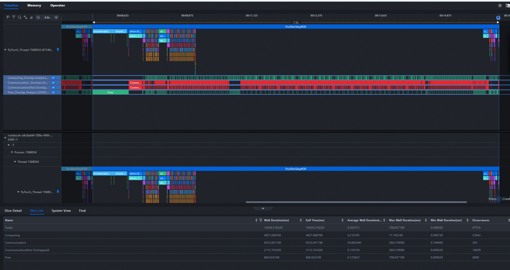

##### 8K · Hyper FSDP＋AdamW

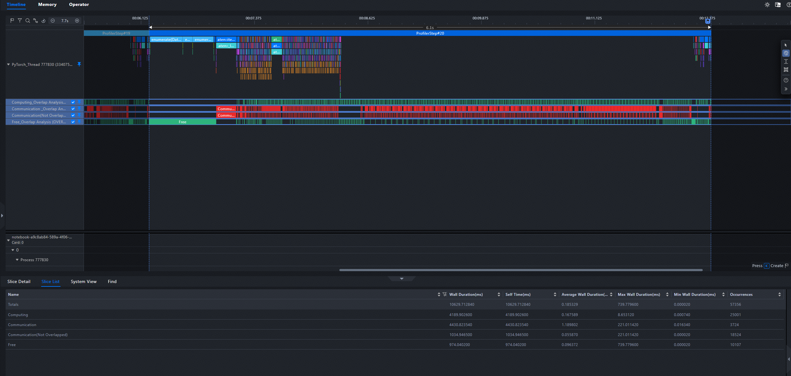

##### 8K · VeOmni FSDP2＋VeOmni Muon std


##### 8K · Hyper FSDP＋Hyper Muon std


#### 精度对比

##### 8K（历史性能运行）

VeOmni FSDP2＋AdamW / Hyper FSDP＋AdamW

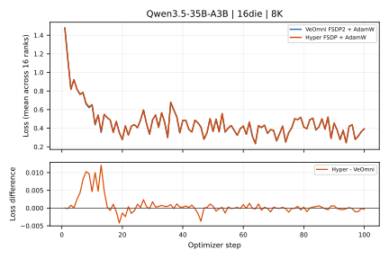

VeOmni FSDP2＋VeOmni Muon std / Hyper FSDP＋Hyper Muon std


##### 8K · AdamW逐位精度对照（100步）

精度验证仅调整：`lr_decay_style=constant`、`max_grad_norm=.inf`、`enable_full_determinism=true`；新增环境变量：`HCCL_DETERMINISTIC=strict`、`NPU_DETERMINISTIC=1`、`PYTHONHASHSEED=42`。


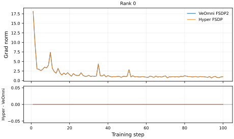

100步对照中，16个rank的loss、grad_norm逐位一致，最大绝对差均为0；已检查的梯度和更新后权重也逐位一致。

##### 8K · AdamW开启梯度裁剪的逐位精度对照（100步）

沿用上述精度验证配置，仅将`max_grad_norm`改为`1.0`。

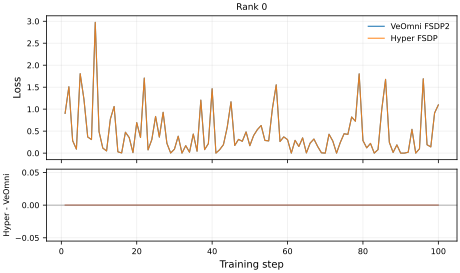

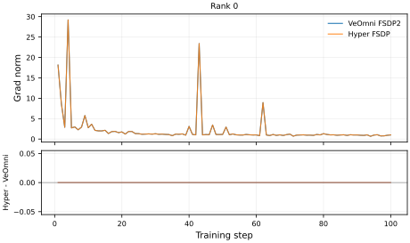

100步对照中，16个rank的loss、grad_norm逐位一致，最大绝对差均为0；已检查的裁剪后梯度和更新后权重也逐位一致。

##### 8K · AdamW非确定性基线重复对照（100步）

VeOmni FSDP2＋AdamW重复运行两次，沿用性能实验配置。

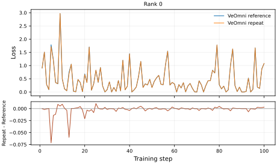

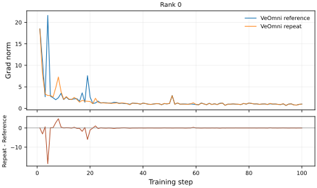

##### 8K · EP=16、SP=2的AdamW对照（100步）

沿用上述模型、数据及环境变量配置，对比VeOmni FSDP2＋AdamW与Hyper FSDP＋AdamW。

```text
单机16die，SP=2，EP=16，dp_shard_size=8，replicate=1
完全重算（非重入），max_seq_len=8192
micro batch size=1，GBS=16；每组100步
```

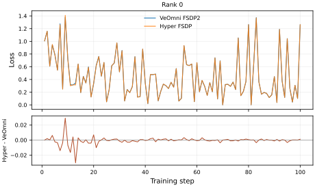

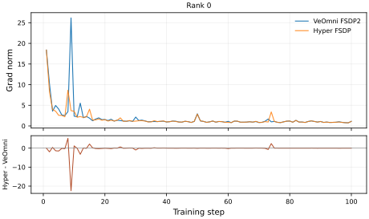

### 4机64die

基于 VeOmni 官方 example：[AdamW](https://github.com/ByteDance-Seed/VeOmni/blob/main/configs/multimodal/qwen3_5_moe/qwen3_5_moe_vl_ascendc.yaml)、[Muon](https://github.com/ByteDance-Seed/VeOmni/blob/main/configs/multimodal/qwen3_5_moe/qwen3_5_moe_vl_muon_ascendc.yaml)，加载完整预训练权重，其余模型、算子及优化器配置沿用对应 example。

数据：Tulu-3 SFT、ShareGPT4V COCO图文128条、LLaVA视频10条，权重依次为0.2、0.4、0.4；图文和视频重复采样。

环境变量：`CPU_AFFINITY_CONF=2`、`TASK_QUEUE_ENABLE=2`、`PYTORCH_NPU_ALLOC_CONF=expandable_segments:True`。

#### HSDP shard=32，replicate=2

```text
64die，SP=1，EP=1，HSDP shard=32，replicate=2
完全重算（非重入），max_seq_len=16384，pad_to_length=false
micro batch size=1，梯度累加数=1，GBS=64；每组100步
```

##### 实验情况

| 序列长度 | 方案 | 单步耗时（s） | 性能提升（%） | 峰值显存 allocated（GiB） | 显存节省 allocated（%） |
| --- | --- | --- | --- | --- | --- |
| 16K | **VeOmni FSDP2＋AdamW（基线）** | 15.00 | — | 35.34 | — |
| 16K | Hyper HSDP＋AdamW | 13.47 | 11.35 | 35.38 | -0.11 |
| 16K | **VeOmni FSDP2＋VeOmni Muon std（基线）** | 15.94 | — | 31.37 | — |
| 16K | Hyper HSDP＋Hyper Muon std | 13.76 | 15.84 | 30.68 | 2.20 |

##### Profiling

###### 16K · VeOmni FSDP2＋AdamW

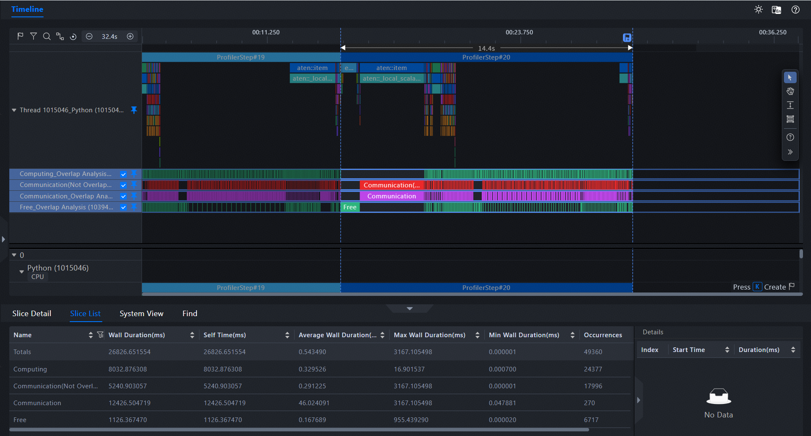

###### 16K · Hyper HSDP＋AdamW


###### 16K · VeOmni FSDP2＋VeOmni Muon std


###### 16K · Hyper HSDP＋Hyper Muon std


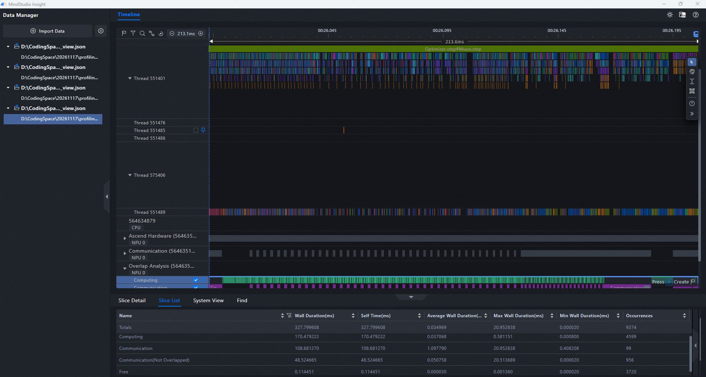

##### 精度对比

VeOmni FSDP2＋AdamW / Hyper HSDP＋AdamW


VeOmni FSDP2＋VeOmni Muon std / Hyper HSDP＋Hyper Muon std

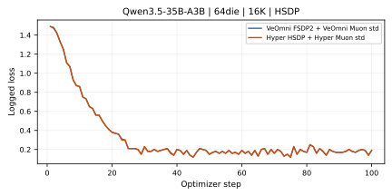

#### FSDP shard=64，replicate=1

```text
64die，SP=1，EP=1，FSDP shard=64，replicate=1
完全重算（非重入），max_seq_len=16384，pad_to_length=false
micro batch size=1，梯度累加数=1，GBS=64；每组100步
```

##### 实验情况

| 序列长度 | 方案 | 单步耗时（s） | 性能提升（%） | 峰值显存 allocated（GiB） | 显存节省 allocated（%） |
| --- | --- | --- | --- | --- | --- |
| 16K | **VeOmni FSDP2＋AdamW（基线）** | 15.59 | — | 27.83 | — |
| 16K | Hyper FSDP＋AdamW | 13.41 | 16.23 | 27.86 | -0.11 |
| 16K | **VeOmni FSDP2＋VeOmni Muon std（基线）** | 15.82 | — | 25.85 | — |
| 16K | Hyper FSDP＋Hyper Muon std | 13.78 | 14.80 | 25.87 | -0.08 |

##### Profiling

###### 16K · VeOmni FSDP2＋AdamW

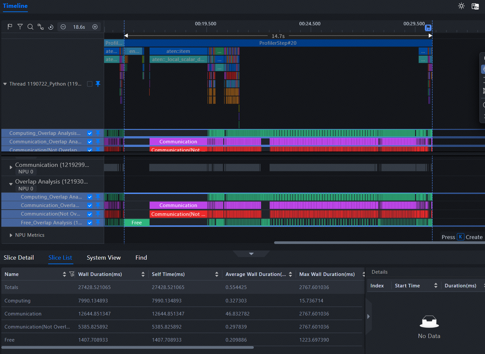

###### 16K · Hyper FSDP＋AdamW


###### 16K · VeOmni FSDP2＋VeOmni Muon std

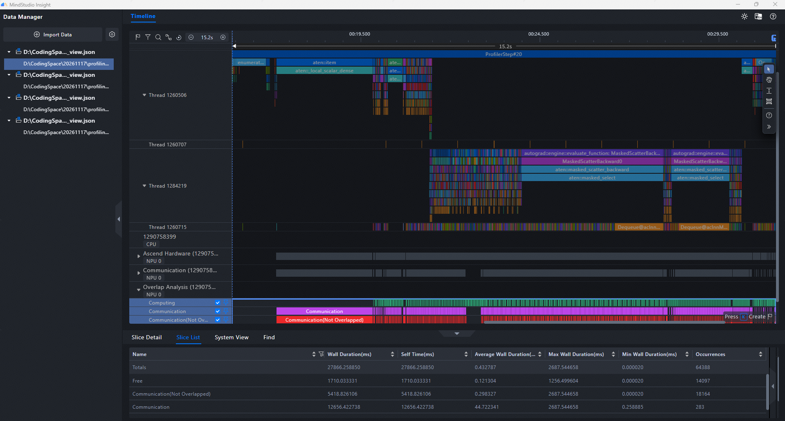

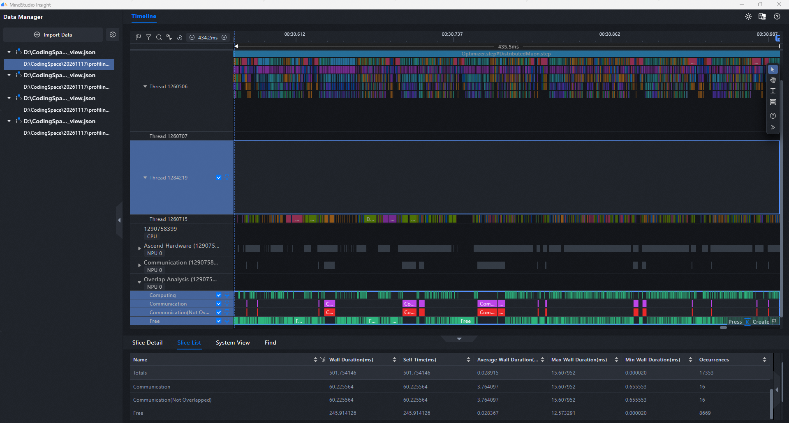

###### 16K · Hyper FSDP＋Hyper Muon std

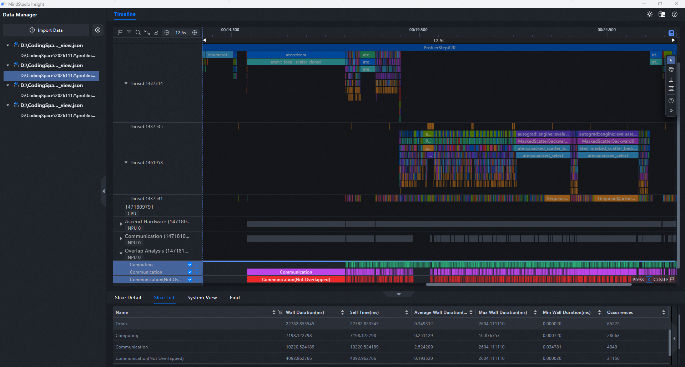

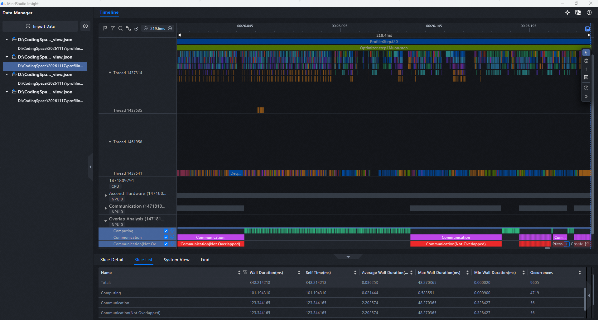

##### 精度对比

VeOmni FSDP2＋AdamW / Hyper FSDP＋AdamW


VeOmni FSDP2＋VeOmni Muon std / Hyper FSDP＋Hyper Muon std

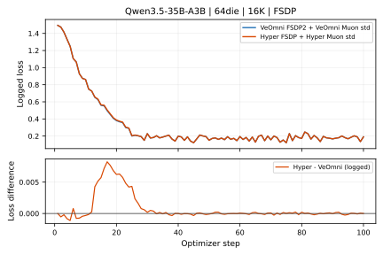

### 性能分析

以下为 Muon 方案的 profiling 阶段统计。16die使用本轮rank0第20、21步的平均值，Backward包含梯度裁剪。

#### 整体与分阶段结果

| 配置 | 阶段 | VeOmni 耗时（s） | Hyper 耗时（s） | 耗时下降（%） |
| --- | --- | --- | --- | --- |
| 16die / 8K | Forward | 1.700 | 1.330 | 21.75 |
| 16die / 8K | Backward | 5.159 | 4.120 | 20.15 |
| 16die / 8K | Optimizer | 0.723 | 0.473 | 34.51 |
| 16die / 8K | **阶段合计** | **7.582** | **5.923** | **21.88** |
| 64die / 16K | Forward | 6.917 | 6.321 | 8.62 |
| 64die / 16K | Backward | 7.2202 | 6.023 | 16.58 |
| 64die / 16K | Optimizer | 0.479 | 0.386 | 19.42 |
| 64die / 16K | **阶段合计** | **14.6162** | **12.730** | **12.90** |

Forward、Backward、Optimizer 各阶段的耗时，包含计算、未被计算掩盖的通信和空闲时间。16die / 8K 的三个阶段合计减少 1.659s，其中反向减少 1.039s；64die / 16K 合计减少 1.8862s，其中反向减少 1.1972s。两组省下来的时间，均有约 63% 来自反向阶段。

#### 计算与通信

| 配置 | 汇总项 | VeOmni 耗时（s） | Hyper 耗时（s） | 耗时下降（%） |
| --- | --- | --- | --- | --- |
| 16die / 8K | 计算 | 5.438 | 4.495 | 17.35 |
| 16die / 8K | 未被计算掩盖的通信 | 1.356 | 0.603 | 55.55 |
| 64die / 16K | 计算 | 8.131 | 7.249 | 10.85 |
| 64die / 16K | 未被计算掩盖的通信 | 5.415 | 4.448 | 17.86 |

两组的计算耗时和未被计算掩盖的通信耗时都有减少。16die / 8K 的整体通信掩盖率由 74.90% 提高到 84.83%。64die / 16K 下，Hyper 前向阶段仍有 56.15% 的时间花在未被计算掩盖的通信上。

Optimizer 的计算耗时，16die / 8K 从 0.538s 减少到 0.372s，64die / 16K 从 0.257s 减少到 0.197s，分别减少 30.83% 和 23.35%。

16die的梯度裁剪及衔接区间由 0.136s 增加到 0.160s，约增加 24ms，已包含在上述Backward耗时中。

#### 后续优化方向

##### ViT 使用 ZeRO-1，LLM 保持 ZeRO-3

不同 rank 的图像、视频输入量不一样，ViT 的计算进度可能不一致，快的 rank 会在通信时等待慢的 rank。ViT 约有 0.5B 参数，可以考虑使用 ZeRO-1，减少参数 AllGather 和同步等待；LLM 继续使用 ZeRO-3，控制显存占用。

##### MatMul dW 直接输出 FP32 梯度

权重梯度 MatMul 直接输出 FP32 梯度，供后续梯度累积或优化器使用，省去单独的 cast 算子和中间张量读写。

## 实验二：Qwen3.8-Flash-Next

配置：加载 Qwen3.8-Flash-Next 预训练权重，使用 VeOmni AdamW（学习率 1e-5、cosine 衰减、weight decay 0、梯度裁剪 1.0）；参数为 BF16、梯度归约为 FP32。两组除 FSDP 后端外使用相同训练配置，Hyper 的通信融合关闭、前向预取深度为 2、反向为 1。

数据：Tulu-3 SFT 文本对话数据（`tulu-3-sft-mixture`），动态 batch 并 pad 至配置长度，最大序列长度 131072；随机种子 42。

环境变量：`TASK_QUEUE_ENABLE=2`、`OMP_NUM_THREADS=1`、`MKL_NUM_THREADS=1`、`PYTORCH_NPU_ALLOC_CONF=expandable_segments:True`、`MULTI_STREAM_MEMORY_REUSE=2`。

### 8机128die

```text
128die，SP=8，EP=8，PLE=8，FSDP shard=128，replicate=1
完全重算（非重入），每rank序列长度16K
micro batch size=1，梯度累加数=1，GBS=16；每组100步
```

#### 实验情况

| 序列长度 | 方案 | 单步耗时（s） | 性能提升（%） | 峰值显存 allocated / reserved（GiB） | 显存节省 allocated / reserved（%） |
| --- | --- | --- | --- | --- | --- |
| 16K | **VeOmni FSDP2＋AdamW（基线）** | 44.8834 | — | 47.82 / 54.61 | — / — |
| 16K | Hyper FSDP＋AdamW | 44.5621 | 0.72 | 47.86 / 51.23 | -0.09 / 6.19 |
| 16K | **VeOmni FSDP2＋VeOmni Muon std（基线）** | 48.2736 | — | 43.92 / 50.74 | — / — |
| 16K | Hyper FSDP＋Hyper Muon std | 46.7510 | 3.26 | 43.36 / 45.97 | 1.27 / 9.40 |

#### Profiling

##### 16K · VeOmni FSDP2＋AdamW

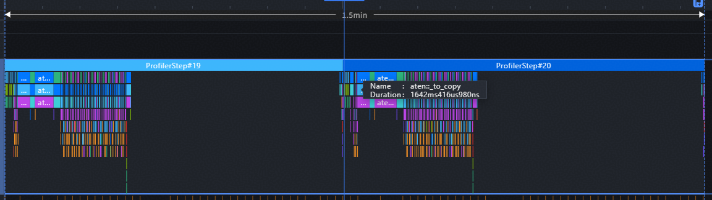

##### 16K · Hyper FSDP＋AdamW


##### 16K · VeOmni FSDP2＋VeOmni Muon std


##### 16K · Hyper FSDP＋Hyper Muon std


#### 精度对比

##### 16K

VeOmni FSDP2＋AdamW / Hyper FSDP＋AdamW


### 性能问题观察

Flash-Next 当前主要有三类性能问题：

1. **计算路径开销**：部分计算触发 AICPU 算子，出现执行断流，影响设备利用率。
2. **Attention 负载不均**：不同 rank 的样本长度和打包组成不同，即使总 token 数接近，Attention 计算量仍可能存在差异。
3. **Triton 在线编译**：数据或输入形状变化导致部分 rank 触发在线编译，拉大执行进度差异，并表现为通信等待和快慢卡现象。

#### AICPU 算子与 Host/Device 同步

截图在 `aten::bincount`、`aten::item` 附近标出了 AICPU 排序算子及 Host/Device 同步。

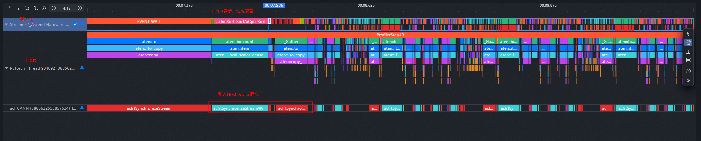

#### Triton kernel 编译开销

截图标注了 rank 33 的 Triton kernel 编译和反向 kernel 编译。

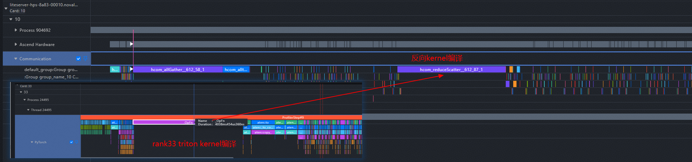

#### Rank 间负载差异

截图标注 rank 8–15 的 FA 片段较长，并以 rank 10 的 11 ms 和 rank 16 的 0.9 ms 为例；两处标注的统计口径仍需结合完整轨迹核对。

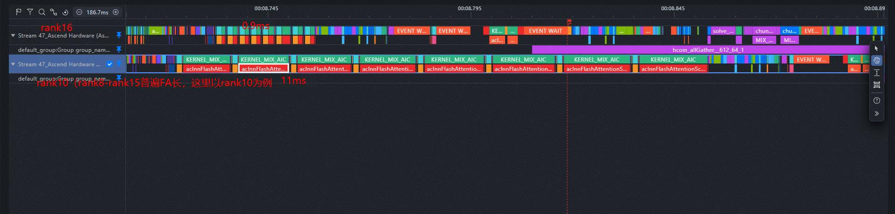

## 实验三：Qwen3-VL-30B-A3B

配置：加载完整的 Qwen3-VL-30B-A3B-Instruct 预训练权重，使用 VeOmni AdamW（学习率 1e-5、cosine 衰减、weight decay 0、梯度裁剪 1.0）；FSDP 混合精度的参数和梯度归约均为 BF16。

Hyper 的 `comm_fusion` 默认关闭，通过启动策略仅对 27 个 ViT block 单独设置 `comm_fusion=True`；前向、反向预取深度均为 1。

数据：Tulu-3 SFT 纯文本对话，过滤超过 2K token 的单条会话后重复采样，动态打包且不补齐；ViT 执行 dummy forward；随机种子 42。

环境变量：`TASK_QUEUE_ENABLE=2`、`PYTORCH_NPU_ALLOC_CONF=expandable_segments:True`、`MULTI_STREAM_MEMORY_REUSE=2`。

### 单机16die

```text
16 die Ascend 910C，SP=1，EP=8，FSDP shard=16，replicate=1
完全重算（非重入），每 rank 打包上限 2K / 4K / 8K / 16K / 32K
micro batch size=1，每步一个 microbatch，GBS=16；每组 100 步
```

#### 实验情况

| 打包上限 | 方案 | 单步耗时（s） | 性能提升（%） | 峰值显存 allocated（GiB） | 显存节省 allocated（%） |
| --- | --- | --- | --- | --- | --- |
| 2K | **VeOmni FSDP2＋AdamW（基线）** | 1.8561 | — | 31.77 | — |
| 2K | Hyper FSDP＋AdamW | 1.6933 | 9.61 | 28.97 | 8.81 |
| 4K | **VeOmni FSDP2＋AdamW（基线）** | 2.3905 | — | 31.78 | — |
| 4K | Hyper FSDP＋AdamW | 2.1628 | 10.53 | 28.97 | 8.84 |
| 8K | **VeOmni FSDP2＋AdamW（基线）** | 3.5626 | — | 32.69 | — |
| 8K | Hyper FSDP＋AdamW | 3.3393 | 6.69 | 29.64 | 9.33 |
| 16K | **VeOmni FSDP2＋AdamW（基线）** | 5.9190 | — | 34.74 | — |
| 16K | Hyper FSDP＋AdamW | 5.6950 | 3.93 | 32.00 | 7.89 |
| 32K | **VeOmni FSDP2＋AdamW（基线）** | 10.7768 | — | 39.42 | — |
| 32K | Hyper FSDP＋AdamW | 10.5733 | 1.92 | 39.06 | 0.91 |

#### 精度对比

VeOmni FSDP2＋AdamW / Hyper FSDP＋AdamW

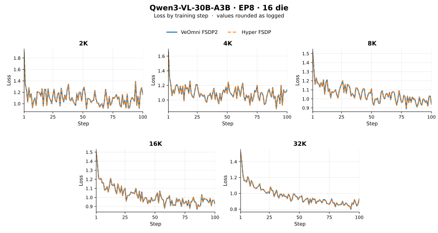

## 技术报告

[HyperParallel-FSDP: Topology-Aware Fully Sharded Training with Layout-Driven Muon on Ascend SuperPods](https://arxiv.org/abs/2609.21594)

## 社区分享

- [HyperParallel FSDP](https://www.zhihu.com/question/648834444/answer/2065147984069842200)
- [HyperParallel Muon](https://www.zhihu.com/question/13193527053/answer/2065364315218170167)
