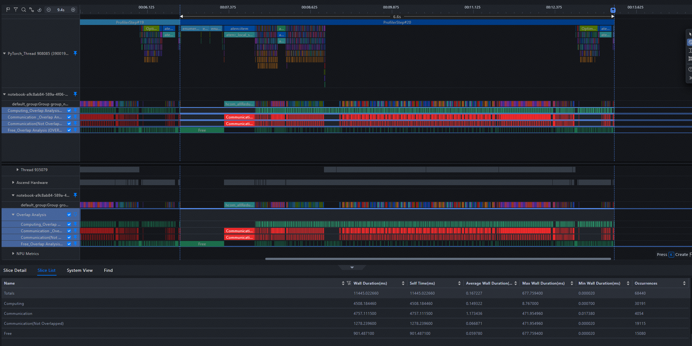
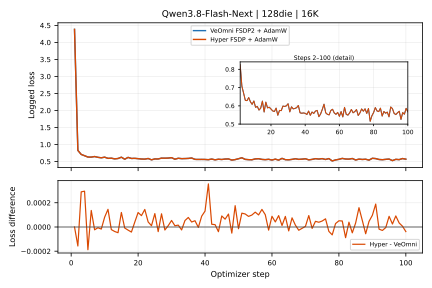

# HyperParallel × VeOmni 训练实验报告

本文在 `docs/veomni-benchmark-report` 分支协作维护，汇总后同步到 [Gist 报告](https://gist.github.com/Cui-yshoho/5a912d774a3693815387fb635b5e46d3)。

## 如何补充结果

- PR 的目标仓库选择 `Cui-yshoho/hyper-parallel`，目标分支选择 `docs/veomni-benchmark-report`。
- 在对应实验下补充配置、数据、性能与显存结果，以及精度图和 profiling 截图；尚未运行的项目保持“待补充”。
- 图片放在 `docs/benchmarks/assets/veomni/`，在本文中使用相对路径引用。原始 profiling 大包不提交到 Git。
- 性能提升按“基线步时 / Hyper 步时 − 1”计算；显存节省分别比较 allocated 和 reserved。

## 实验一：Qwen3.5-35B-A3B

### 单机16die

基于 VeOmni 官方 example：[AdamW](https://github.com/ByteDance-Seed/VeOmni/blob/main/configs/multimodal/qwen3_5_moe/qwen3_5_moe_vl_ascendc.yaml)、[Muon](https://github.com/ByteDance-Seed/VeOmni/blob/main/configs/multimodal/qwen3_5_moe/qwen3_5_moe_vl_muon_ascendc.yaml)，加载完整预训练权重，其余模型、算子及优化器配置沿用对应 example。

数据：Tulu-3 SFT、ShareGPT4V COCO图文128条、LLaVA视频10条，权重依次为0.2、0.4、0.4；图文和视频重复采样。

环境变量：`CPU_AFFINITY_CONF=2`、`TASK_QUEUE_ENABLE=2`、`PYTORCH_NPU_ALLOC_CONF=expandable_segments:True`。

```text
16die，SP=1，EP=1，FSDP shard=16，replicate=1
完全重算（非重入），每rank序列长度8K
micro batch size=1，梯度累加数=1，GBS=16；每组100步
```

#### 实验情况

| 序列长度 | 方案 | 单步耗时（s） | 性能提升（%） | 峰值显存 allocated / reserved（GiB） | 显存节省 allocated / reserved（%） |
| --- | --- | --- | --- | --- | --- |
| 8K | **VeOmni FSDP2＋AdamW（基线）** | 7.6849 | — | 47.24 / 54.99 | — / — |
| 8K | Hyper FSDP＋AdamW | 5.8394 | 31.61 | 47.34 / 50.70 | -0.21 / 7.80 |
| 8K | **VeOmni FSDP2＋VeOmni Muon std（基线）** | 7.8723 | — | 39.30 / 47.13 | — / — |
| 8K | Hyper FSDP＋Hyper Muon std | 6.0993 | 29.07 | 39.40 / 42.66 | -0.25 / 9.48 |

#### Profiling

##### 8K · VeOmni FSDP2＋AdamW


##### 8K · Hyper FSDP＋AdamW


##### 8K · VeOmni FSDP2＋VeOmni Muon std


##### 8K · Hyper FSDP＋Hyper Muon std



#### 精度对比

##### 8K

VeOmni FSDP2＋AdamW / Hyper FSDP＋AdamW


VeOmni FSDP2＋VeOmni Muon std / Hyper FSDP＋Hyper Muon std


### 4机64die

配置：待补充。

数据：待补充。

环境变量：`CPU_AFFINITY_CONF=2`、`TASK_QUEUE_ENABLE=2`、`PYTORCH_NPU_ALLOC_CONF=expandable_segments:True`。

```text
64die，SP=1，EP=1，HSDP shard=32，replicate=2
每rank序列长度16K
```

#### 实验情况

| 序列长度 | 方案 | 单步耗时（s） | 性能提升（%） | 峰值显存 allocated / reserved（GiB） | 显存节省 allocated / reserved（%） |
| --- | --- | --- | --- | --- | --- |
| 16K | **VeOmni FSDP2＋AdamW（基线）** | 待补充 | — | 待补充 / 待补充 | — / — |
| 16K | Hyper HSDP＋AdamW | 待补充 | 待补充 | 待补充 / 待补充 | 待补充 / 待补充 |
| 16K | **VeOmni FSDP2＋VeOmni Muon std（基线）** | 待补充 | — | 待补充 / 待补充 | — / — |
| 16K | Hyper HSDP＋Hyper Muon std | 待补充 | 待补充 | 待补充 / 待补充 | 待补充 / 待补充 |

#### Profiling

##### 16K · VeOmni FSDP2＋AdamW

截图待补充。

##### 16K · Hyper HSDP＋AdamW

截图待补充。

##### 16K · VeOmni FSDP2＋VeOmni Muon std

截图待补充。

##### 16K · Hyper HSDP＋Hyper Muon std

截图待补充。

#### 精度对比

##### 16K

VeOmni FSDP2＋AdamW / Hyper HSDP＋AdamW loss对比图：待补充。

VeOmni FSDP2＋VeOmni Muon std / Hyper HSDP＋Hyper Muon std loss对比图：待补充。

## 实验二：Qwen3.8-Flash-Next

配置：加载 Qwen3.8-Flash-Next 预训练权重，使用 VeOmni AdamW（学习率 1e-5、cosine 衰减、weight decay 0、梯度裁剪 1.0）；参数为 BF16、梯度归约为 FP32。两组除 FSDP 后端外使用相同训练配置，Hyper 的通信融合关闭、前向预取深度为 2、反向为 1。

数据：Tulu-3 SFT 文本对话数据（`tulu-3-sft-mixture`），动态 batch 并 pad 至配置长度，最大序列长度 131072；随机种子 42。两组分别在相同 8 台机器上串行运行，对比 128 个 rank × 100 步的输入摘要，12800 项均一致。

环境：每个 rank 绑定两个独立 CPU 核；`TASK_QUEUE_ENABLE=2`、`OMP_NUM_THREADS=1`、`MKL_NUM_THREADS=1`、`PYTORCH_NPU_ALLOC_CONF=expandable_segments:True`、`MULTI_STREAM_MEMORY_REUSE=2`。

### 8机128die

```text
128die，SP=8，EP=8，PLE=8，replicate=1
dp_shard_size=16，与 SP=8 组成 128 卡设备网格；普通参数 FSDP shard=128
完全重算（非重入），每 rank 序列长度 16K
micro batch size=1，每步一个 microbatch，GBS=16；每组 100 步
```

#### 实验情况

| 序列长度 | 方案 | 单步耗时（s） | 性能提升（%） | 峰值显存 allocated / reserved（GiB） | 显存节省 allocated / reserved（%） |
| --- | --- | --- | --- | --- | --- |
| 16K | **VeOmni FSDP2＋AdamW（基线）** | 44.8834 | — | 47.82 / 54.61 | — / — |
| 16K | Hyper FSDP＋AdamW | 44.5621 | 0.72 | 47.86 / 51.23 | -0.09 / 6.19 |
| 16K | **VeOmni FSDP2＋VeOmni Muon std（基线）** | 待补充 | — | 待补充 / 待补充 | — / — |
| 16K | Hyper FSDP＋Hyper Muon std | 待补充 | 待补充 | 待补充 / 待补充 | 待补充 / 待补充 |

步时取 rank 0 日志的同一步配对平均，排除前 5 步预热和第 17–21 步 profiling 预热及采集，共 90 步；其中 Hyper 有 47 步更快、43 步更慢。按两组步时和配对步时差的 1.5 倍 IQR 检查后，第 61 步被标为配对差值异常；若两组均剔除该步，剩余 89 步的均值为 44.9103 / 44.5220 s，按本文性能公式提升 0.87%。这是同一组机器上的单次串行对比，差异较小；异常标记不等同于日志错误。

显存取每组 100 步中所有 128 个 rank 各自峰值的最大值，allocated 和 reserved 分别比较；负的节省率表示占用增加。上述百分比由未四舍五入的数据计算。[100 步原始耗时、loss、梯度范数及筛选标记](assets/veomni/steps_128die_16k_adamw.csv)；未参与 IQR 检查的预热和 profiling 步，其异常标记留空。[各 rank 显存峰值](assets/veomni/memory_128die_16k_adamw.csv)。

#### Profiling

##### 16K · VeOmni FSDP2＋AdamW

截图待补充。

##### 16K · Hyper FSDP＋AdamW

截图待补充。

##### 16K · VeOmni FSDP2＋VeOmni Muon std

截图待补充。

##### 16K · Hyper FSDP＋Hyper Muon std

截图待补充。

#### 精度对比

##### 16K

VeOmni FSDP2＋AdamW / Hyper FSDP＋AdamW



图中为 rank 0 日志记录的 100 步 loss，下图为 Hyper 减 VeOmni；两组最大绝对差约为 0.0003553（第 41 步）。该对比反映本次运行的 loss 曲线，不代表逐位一致或完整精度验收。图中数据保留日志原始精度。

VeOmni FSDP2＋VeOmni Muon std / Hyper FSDP＋Hyper Muon std loss对比图：待补充。

## 实验三：Qwen3.5-397B-A17B

配置：待补充。

数据：待补充。

环境变量：`CPU_AFFINITY_CONF=2`、`TASK_QUEUE_ENABLE=2`、`PYTORCH_NPU_ALLOC_CONF=expandable_segments:True`。

### 8机128die

```text
128die，SP=8，EP=8，FSDP shard=128
每rank序列长度8K / 16K
```

#### 实验情况

| 序列长度 | 方案 | 单步耗时（s） | 性能提升（%） | 峰值显存 allocated / reserved（GiB） | 显存节省 allocated / reserved（%） |
| --- | --- | --- | --- | --- | --- |
| 8K | **VeOmni FSDP2＋AdamW（基线）** | 待补充 | — | 待补充 / 待补充 | — / — |
| 8K | Hyper FSDP＋AdamW | 待补充 | 待补充 | 待补充 / 待补充 | 待补充 / 待补充 |
| 8K | **VeOmni FSDP2＋VeOmni Muon std（基线）** | 待补充 | — | 待补充 / 待补充 | — / — |
| 8K | Hyper FSDP＋Hyper Muon std | 待补充 | 待补充 | 待补充 / 待补充 | 待补充 / 待补充 |
| 16K | **VeOmni FSDP2＋AdamW（基线）** | 待补充 | — | 待补充 / 待补充 | — / — |
| 16K | Hyper FSDP＋AdamW | 待补充 | 待补充 | 待补充 / 待补充 | 待补充 / 待补充 |
| 16K | **VeOmni FSDP2＋VeOmni Muon std（基线）** | 待补充 | — | 待补充 / 待补充 | — / — |
| 16K | Hyper FSDP＋Hyper Muon std | 待补充 | 待补充 | 待补充 / 待补充 | 待补充 / 待补充 |

#### Profiling

##### 8K · VeOmni FSDP2＋AdamW

截图待补充。

##### 8K · Hyper FSDP＋AdamW

截图待补充。

##### 8K · VeOmni FSDP2＋VeOmni Muon std

截图待补充。

##### 8K · Hyper FSDP＋Hyper Muon std

截图待补充。

##### 16K · VeOmni FSDP2＋AdamW

截图待补充。

##### 16K · Hyper FSDP＋AdamW

截图待补充。

##### 16K · VeOmni FSDP2＋VeOmni Muon std

截图待补充。

##### 16K · Hyper FSDP＋Hyper Muon std

截图待补充。

#### 精度对比

##### 8K

VeOmni FSDP2＋AdamW / Hyper FSDP＋AdamW loss对比图：待补充。

VeOmni FSDP2＋VeOmni Muon std / Hyper FSDP＋Hyper Muon std loss对比图：待补充。

##### 16K

VeOmni FSDP2＋AdamW / Hyper FSDP＋AdamW loss对比图：待补充。

VeOmni FSDP2＋VeOmni Muon std / Hyper FSDP＋Hyper Muon std loss对比图：待补充。
