# HyperParallel × VeOmni 训练实验报告

<!-- markdownlint-configure-file {"MD033": {"allowed_elements": ["img"]}} -->

## HyperParallel 接入配置

```yaml
hyper_parallel:
  comm_fusion: false        # 将参数/梯度打包到 buffer，进行融合通信
  comm_fusion_vit: null     # 单独控制视觉塔的通信融合；null 表示继承 comm_fusion
  forward_prefetch_depth: 1 # 前向预取后续 block 的数量，需开启 forward_prefetch
  backward_prefetch_depth: 1 # 反向预取前面 block 的数量
  reduce_comm_interval: 1   # 梯度归约通信的等待间隔，不是梯度累加步数
```

`apply_hyper_parallel_patch` 由 VeOmni 在模型构建前自动调用，根据配置将 FSDP/HSDP 或 Muon 的构建入口切换到 Hyper 实现，并适配权重加载、梯度裁剪和 checkpoint 保存恢复所需的 DTensor 转换；数据加载和训练循环仍由 VeOmni 管理。

### 单机16die

基于 VeOmni 官方 example：[AdamW](https://github.com/ByteDance-Seed/VeOmni/blob/main/configs/multimodal/qwen3_5_moe/qwen3_5_moe_vl_ascendc.yaml)、[Muon](https://github.com/ByteDance-Seed/VeOmni/blob/main/configs/multimodal/qwen3_5_moe/qwen3_5_moe_vl_muon_ascendc.yaml)，加载完整预训练权重，其余模型、算子及优化器配置沿用对应 example。

数据：Tulu-3 SFT、ShareGPT4V COCO图文128条、LLaVA视频10条，权重依次为0.2、0.4、0.4；图文和视频重复采样。

环境变量：`CPU_AFFINITY_CONF=2`、`TASK_QUEUE_ENABLE=2`、`PYTORCH_NPU_ALLOC_CONF=expandable_segments:True`。

```text
16die，SP=1，EP=1，FSDP shard=16，replicate=1
完全重算（非重入），每rank序列长度8K
micro batch size=1，梯度累加数=1，GBS=16；每组100步
```

#### 实验情况

| 序列长度 | 方案 | 单步耗时（s） | 性能提升（%） | 峰值显存 allocated / reserved（GiB） | 显存节省 allocated / reserved（%） |
| --- | --- | --- | --- | --- | --- |
| 8K | **VeOmni FSDP2＋AdamW（基线）** | 7.6849 | — | 47.24 / 54.99 | — / — |
| 8K | Hyper FSDP＋AdamW | 5.8394 | 31.61 | 47.34 / 50.70 | -0.21 / 7.80 |
| 8K | **VeOmni FSDP2＋VeOmni Muon std（基线）** | 7.8723 | — | 39.30 / 47.13 | — / — |
| 8K | Hyper FSDP＋Hyper Muon std | 6.0993 | 29.07 | 39.40 / 42.66 | -0.25 / 9.48 |

#### Profiling

##### 8K · VeOmni FSDP2＋AdamW


##### 8K · Hyper FSDP＋AdamW


##### 8K · VeOmni FSDP2＋VeOmni Muon std


##### 8K · Hyper FSDP＋Hyper Muon std


#### 精度对比

##### 8K

VeOmni FSDP2＋AdamW / Hyper FSDP＋AdamW


VeOmni FSDP2＋VeOmni Muon std / Hyper FSDP＋Hyper Muon std


### 4机64die

基于 VeOmni 官方 example：[AdamW](https://github.com/ByteDance-Seed/VeOmni/blob/main/configs/multimodal/qwen3_5_moe/qwen3_5_moe_vl_ascendc.yaml)、[Muon](https://github.com/ByteDance-Seed/VeOmni/blob/main/configs/multimodal/qwen3_5_moe/qwen3_5_moe_vl_muon_ascendc.yaml)，加载完整预训练权重，其余模型、算子及优化器配置沿用对应 example。

数据：Tulu-3 SFT、ShareGPT4V COCO图文128条、LLaVA视频10条，权重依次为0.2、0.4、0.4；图文和视频重复采样。

环境变量：`CPU_AFFINITY_CONF=2`、`TASK_QUEUE_ENABLE=2`、`PYTORCH_NPU_ALLOC_CONF=expandable_segments:True`。

#### HSDP shard=32，replicate=2

```text
64die，SP=1，EP=1，HSDP shard=32，replicate=2
完全重算（非重入），max_seq_len=16384，pad_to_length=false
micro batch size=1，梯度累加数=1，GBS=64；每组100步
```

##### 实验情况

| 序列长度 | 方案 | 单步耗时（s） | 性能提升（%） | 峰值显存 allocated（GiB） | 显存节省 allocated（%） |
| --- | --- | --- | --- | --- | --- |
| 16K | **VeOmni FSDP2＋AdamW（基线）** | 15.00 | — | 35.34 | — |
| 16K | Hyper HSDP＋AdamW | 13.47 | 11.35 | 35.38 | -0.11 |
| 16K | **VeOmni FSDP2＋VeOmni Muon std（基线）** | 15.94 | — | 31.37 | — |
| 16K | Hyper HSDP＋Hyper Muon std | 13.69 | 16.48 | 30.68 | 2.20 |

##### Profiling

###### 16K · VeOmni FSDP2＋AdamW


###### 16K · Hyper HSDP＋AdamW

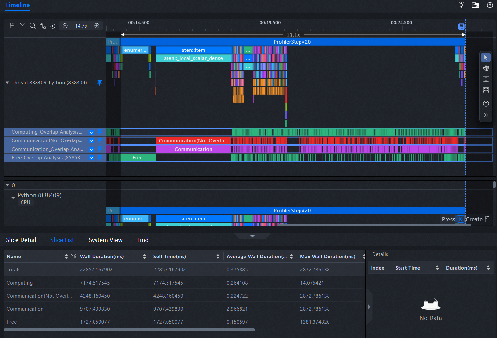

###### 16K · VeOmni FSDP2＋VeOmni Muon std

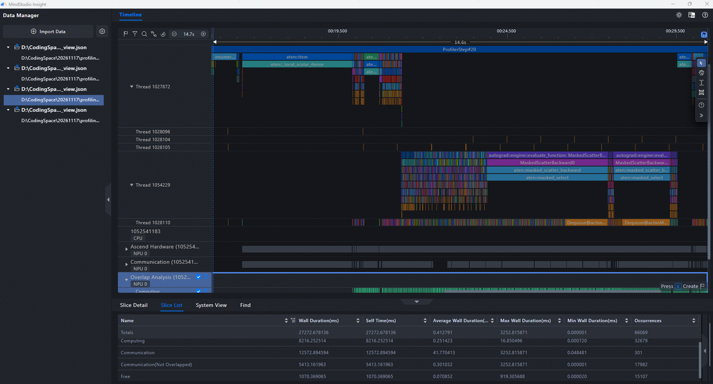

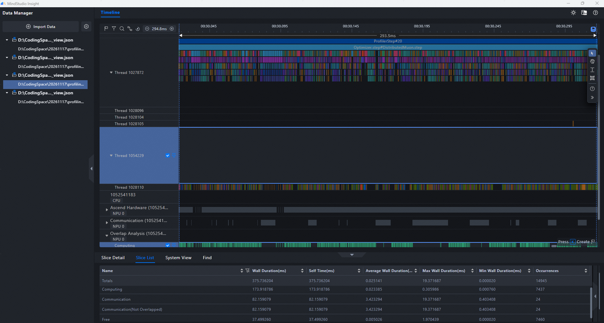

###### 16K · Hyper HSDP＋Hyper Muon std

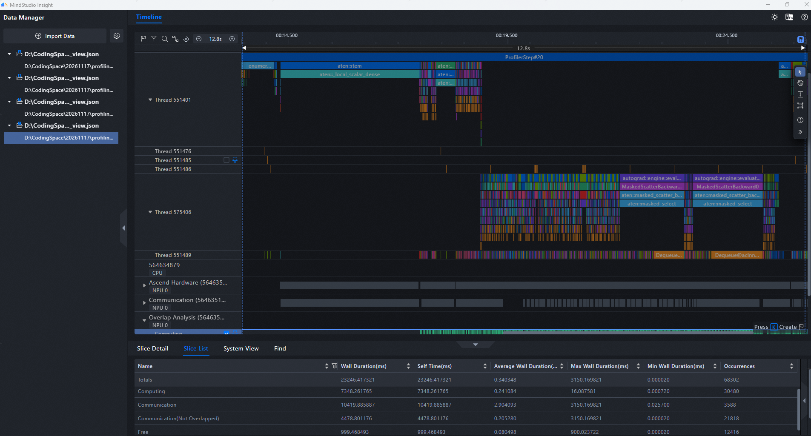


##### 精度对比

VeOmni FSDP2＋AdamW / Hyper HSDP＋AdamW

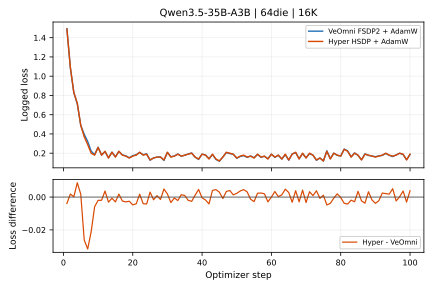

VeOmni FSDP2＋VeOmni Muon std / Hyper HSDP＋Hyper Muon std


#### FSDP shard=64，replicate=1

```text
64die，SP=1，EP=1，FSDP shard=64，replicate=1
完全重算（非重入），max_seq_len=16384，pad_to_length=false
micro batch size=1，梯度累加数=1，GBS=64；每组100步
```

##### 实验情况

| 序列长度 | 方案 | 单步耗时（s） | 性能提升（%） | 峰值显存 allocated（GiB） | 显存节省 allocated（%） |
| --- | --- | --- | --- | --- | --- |
| 16K | **VeOmni FSDP2＋AdamW（基线）** | 15.59 | — | 27.83 | — |
| 16K | Hyper FSDP＋AdamW | 13.41 | 16.23 | 27.86 | -0.11 |
| 16K | **VeOmni FSDP2＋VeOmni Muon std（基线）** | 15.82 | — | 25.85 | — |
| 16K | Hyper FSDP＋Hyper Muon std | 13.75 | 15.12 | 25.87 | -0.08 |

##### Profiling

###### 16K · VeOmni FSDP2＋AdamW


###### 16K · Hyper FSDP＋AdamW

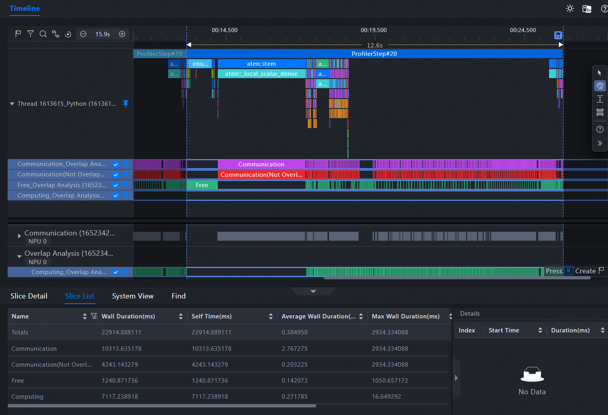

###### 16K · VeOmni FSDP2＋VeOmni Muon std


###### 16K · Hyper FSDP＋Hyper Muon std


##### 精度对比

VeOmni FSDP2＋AdamW / Hyper FSDP＋AdamW

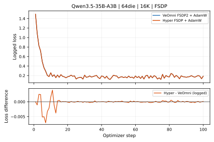

VeOmni FSDP2＋VeOmni Muon std / Hyper FSDP＋Hyper Muon std


## 实验二：Qwen3.8-Flash-Next

配置：加载 Qwen3.8-Flash-Next 预训练权重，使用 VeOmni AdamW（学习率 1e-5、cosine 衰减、weight decay 0、梯度裁剪 1.0）；参数为 BF16、梯度归约为 FP32。两组除 FSDP 后端外使用相同训练配置，Hyper 的通信融合关闭、前向预取深度为 2、反向为 1。

数据：Tulu-3 SFT 文本对话数据（`tulu-3-sft-mixture`），动态 batch 并 pad 至配置长度，最大序列长度 131072；随机种子 42。

环境变量：`TASK_QUEUE_ENABLE=2`、`OMP_NUM_THREADS=1`、`MKL_NUM_THREADS=1`、`PYTORCH_NPU_ALLOC_CONF=expandable_segments:True`、`MULTI_STREAM_MEMORY_REUSE=2`。

### 8机128die

```text
128die，SP=8，EP=8，PLE=8，FSDP shard=128，replicate=1
完全重算（非重入），每rank序列长度16K
micro batch size=1，梯度累加数=1，GBS=16；每组100步
```

#### 实验情况

| 序列长度 | 方案 | 单步耗时（s） | 性能提升（%） | 峰值显存 allocated / reserved（GiB） | 显存节省 allocated / reserved（%） |
| --- | --- | --- | --- | --- | --- |
| 16K | **VeOmni FSDP2＋AdamW（基线）** | 44.8834 | — | 47.82 / 54.61 | — / — |
| 16K | Hyper FSDP＋AdamW | 44.5621 | 0.72 | 47.86 / 51.23 | -0.09 / 6.19 |
| 16K | **VeOmni FSDP2＋VeOmni Muon std（基线）** | 48.2736 | — | 43.92 / 50.74 | — / — |
| 16K | Hyper FSDP＋Hyper Muon std | 46.7510 | 3.26 | 43.36 / 45.97 | 1.27 / 9.40 |

#### Profiling

##### 16K · VeOmni FSDP2＋AdamW


##### 16K · Hyper FSDP＋AdamW

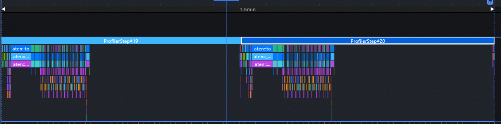

##### 16K · VeOmni FSDP2＋VeOmni Muon std

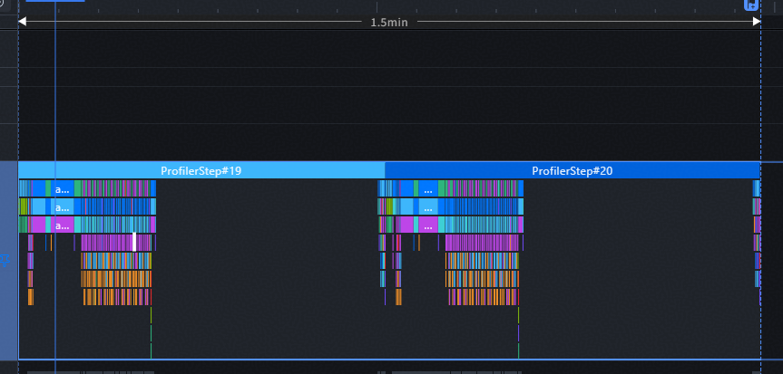

##### 16K · Hyper FSDP＋Hyper Muon std

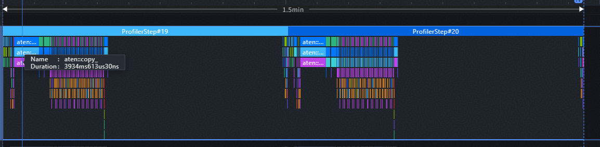

#### 精度对比

##### 16K

VeOmni FSDP2＋AdamW / Hyper FSDP＋AdamW


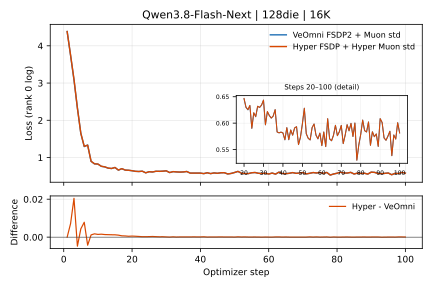

## 实验三：Qwen3-VL-30B-A3B

配置：加载完整的 Qwen3-VL-30B-A3B-Instruct 预训练权重，使用 VeOmni AdamW（学习率 1e-5、cosine 衰减、weight decay 0、梯度裁剪 1.0）；FSDP 混合精度的参数和梯度归约均为 BF16。VeOmni 使用 `b0f4e893`，HyperParallel 使用 `ada54bd4`。

Hyper 的 `comm_fusion` 默认关闭，通过启动策略仅对 27 个 ViT block 单独设置 `comm_fusion=True`；前向、反向预取深度均为 1。

数据：Tulu-3 SFT 纯文本对话，过滤超过 2K token 的单条会话后重复采样，动态打包且不补齐；ViT 执行 dummy forward。表中长度为每 rank 的打包 token 上限，并非单条会话长度；随机种子 42。

运行时按 rank 绑核；环境变量：`TASK_QUEUE_ENABLE=2`、`PYTORCH_NPU_ALLOC_CONF=expandable_segments:True`、`MULTI_STREAM_MEMORY_REUSE=2`。

### 单机16die

```text
16 die Ascend 910C，SP=1，EP=8，FSDP shard=16，replicate=1
完全重算（非重入），每 rank 打包上限 2K / 4K / 8K / 16K / 32K
micro batch size=1，每步一个 microbatch，GBS=16；每组 100 步
```

#### 实验情况

单步耗时按第 23–100 步统计；性能提升按 Torch 步时 / Hyper 步时 − 1 计算。峰值显存为 rank 0 的 allocated 值。

| 打包上限 | 方案 | 单步耗时（s） | 性能提升（%） | 峰值显存 allocated（GiB） | 显存节省 allocated（%） |
| --- | --- | --- | --- | --- | --- |
| 2K | **VeOmni FSDP2＋AdamW（基线）** | 1.8561 | — | 31.77 | — |
| 2K | Hyper FSDP＋AdamW | 1.6933 | 9.61 | 28.97 | 8.81 |
| 4K | **VeOmni FSDP2＋AdamW（基线）** | 2.3905 | — | 31.78 | — |
| 4K | Hyper FSDP＋AdamW | 2.1628 | 10.53 | 28.97 | 8.84 |
| 8K | **VeOmni FSDP2＋AdamW（基线）** | 3.5626 | — | 32.69 | — |
| 8K | Hyper FSDP＋AdamW | 3.3393 | 6.69 | 29.64 | 9.33 |
| 16K | **VeOmni FSDP2＋AdamW（基线）** | 5.9190 | — | 34.74 | — |
| 16K | Hyper FSDP＋AdamW | 5.6950 | 3.93 | 32.00 | 7.89 |
| 32K | **VeOmni FSDP2＋AdamW（基线）** | 10.7768 | — | 39.42 | — |
| 32K | Hyper FSDP＋AdamW | 10.5733 | 1.92 | 39.06 | 0.91 |

#### 精度对比

VeOmni FSDP2＋AdamW / Hyper FSDP＋AdamW。Loss 按训练日志显示值绘制，保留两位小数。


